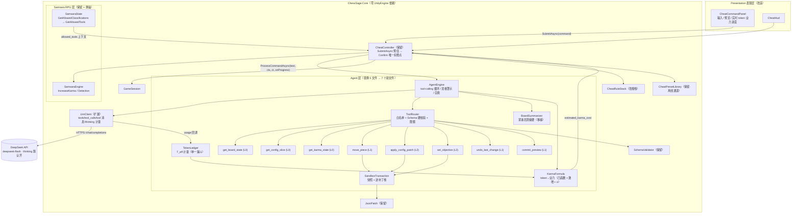

# ChessSage「Agent 重制」工程设计文档

> **任务**：REMAKE-ENG-01（纯设计任务：只读代码、只写本档，不改任何 `.cs` / `.json` / 工程文件）
> **修订**：REMAKE-ENG-02（2026-10-23，纯文档任务）——用户四项裁决回填：§5.5 改「顶格警示不拦截」、§7.1/§7.2 校准合同移交设计侧 §1.4（幂律作废）、新增 §13 性能专章（20s 硬超时 mandate）、新增 §14 实施 Story 拆分。仍未改动任何代码/配置/工程文件。
> **作者**：程基岩（Cheng Jiyan）· 游戏技术与引擎工程师
> **委托**：主理人 游承峰
> **仓库**：`/workspace/ChessSage-Unity`（git main · v1.0.1 已发布 · 工作树干净）
> **引擎**：Unity 2022.3.62f3c1（.NET Standard 2.1 / Mono 运行时）
> **日期**：2026-10-22（REMAKE-ENG-02 修订于 2026-10-23）

---

## 0. 阅读指引

| 读者 | 必读章节 |
|:---|:---|
| 主理人（拍板） | §1 结论摘要、§3 ADR-1、§11 决策点清单、§13 性能专章、§14 实施拆分 |
| 程序设计（落地） | §4 工具集、§5 Agent 循环、§6 LlmClient 扩展、§7 业力算法、§8 迁移、§13 性能、§14 实施拆分 |
| 设计侧（文策渊） | §3.8 ADR-6（门控换轴技术约束）、§12.1 接口要求 |
| QA 侧（严守真） | §10 测试接口要求、§12.2 接口要求 |

**术语**：
- **T_eff**：一次提交全程累计的有效 token（prompt + completion，completion 含 thinking）。
- **sandbox**：提交时对 `BuildConfigs()` 的深拷贝，agent 全部写操作只落在 sandbox，确认后才经既有链路生效。
- **改规栈**：`CheatController._rules`（`CheatRuleStack`），确认后入栈、只存配置切片（不含 board_state）。
- **L0/L1/L2**：工具权限级（L0 只读 / L1 sandbox 写 / L2 特权写）。

---

## 1. 结论摘要（TL;DR）

1. **架构选型（ADR-1）：不采用 Microsoft Agent Framework，也不引官方 MCP C# SDK；在既有 `LlmClient` 上自建「进程内 MCP 风格薄 agent 循环」，零新增外部依赖。** 理由：MAF 1.0 面向 net8+，Unity 2022.3 Mono 无法加载；MCP C# SDK 为预览版且传递依赖未在 Mono 验证，而本游戏的工具全部同进程、无跨进程/跨服务需求，其协议价值（JSON Schema 工具描述 + tool_calls 消息循环）可用约 300 行 Newtonsoft 代码完整复刻；这与「模型强于框架——强工具模型（DeepSeek flash）+ 朴素循环」的从业者共识一致，且换来 Mono 零风险、全量可 mock、token 单点计量。
2. **业力计量（ADR-4）：token→业力在 `LlmClient` 单一漏斗完成。** 每次 `chat/completions` 响应的 `usage` 汇入 `TokenLedger`（T_eff = Σ prompt+completion，thinking 按 DeepSeek 计费口径全额计入 completion）；提交结束时 `KarmaFormula` 由 T_eff **分段线性凸函数**（拟合设计侧 §1.4 锚点，幂律已作废）映射业力；循环中每轮投射预估业力，**触顶只警示不拦截**（裁决 #3：clamp 到 120 放行，玩家可随时「收手」跳车）——旧代码「先 clamp 到 120 再判 >120」的死代码缺陷在新语义下自然消解。
3. **工具集（§4）：8 个进程内工具**——`get_board_state` / `get_config_slice` / `get_karma_state`（L0 只读）、`move_piece` / `undo_last_change` / `commit_preview`（L1）、`apply_config_patch` / `set_objective`（L2 特权写，路径白名单 + Schema 硬校验 + 限额）。每个工具给出完整 JSON Schema、读写属性、权限级与既有机制映射。
4. **迁移（§8）：删 5 写 7 保留 11 改 6 + 2 隐性耦合。** `OrchestratorEngine/OrchestratorActions/PromptBuilder/KarmaEstimator` + `IntentModels.Classification` 整体删除，替换为 `AgentEngine / AgentTools / AgentPrompts / KarmaFormula / TokenLedger / AgentModels / BoardSummarizer` 七个新文件（约 1,800–2,200 行 vs 旧 4,900 行）；`CheatController` 两段式契约与改规栈链路原样保留，仅引擎字段类型与 `SyncAssessor` 体内两行适配；`GetAllowedClassifications` 门控换轴为「工具权限」轴（技术影响面见 ADR-6）。
5. **风险与决策**：无引擎知识缺口；DeepSeek 现行 API 细节（`reasoning_effort`、裸域名 base_url、`completion_tokens_details.reasoning_tokens`）已在线核验并写入 §6；§11 决策点中 ADR-1/校准合同/超上限行为已由用户四项裁决（2026-10-23）定案并回填全文；**新增性能 mandate（裁决 #4）：单任务 20s 硬超时**——完整技术方案见 §13（前缀缓存最大化 + thinking 压缩 + 轮次压缩 + 流式首字），实施拆分见 §14。

---

## 2. 架构总览

### 2.1 目标架构图



### 2.2 新旧流程对照

| 阶段 | 现行（v1.0.1） | 重制后 |
|:---|:---|:---|
| 入口 | `CheatController.SubmitAsync` → `SyncAssessor` → `BuildConfigs` 快照 → `OrchestratorEngine.ProcessCommandAsync` | **不变**（引擎类型换为 `AgentEngine`，上下文键 `allowed_classifications` → `allowed_tools`） |
| 理解 | ChatAI 意图分类（A/B/C/C+/D/D2/E/F）+ 拆 action（全量 config JSON 进 prompt） | **删除**。单 agent：system prompt（含 8 个工具 JSON Schema）+ 紧凑局势摘要；按需用工具读棋盘/配置 |
| 业力 | `KarmaEstimator` 并行 LLM 评估（分类价目表 × 强度 × 局势） | **删除**。`TokenLedger` 计量 T_eff，`KarmaFormula` 凸函数映射；循环中实时投射 |
| 执行 | 逐 action CodeAI 生成 JSON Patch（整份 config 进 prompt）→ Schema 校验 + 最多 2 次重试 | **删除**。agent 自主多轮调工具；工具内即时白名单 + Schema 校验，错误以 tool 消息回喂自愈 |
| 预览 | `ConvertResult` → `CheatDiffRenderer` → `CheatPreview` | **不变**（结果契约保持：`type=applied/partial/fun/rejected/error` + `modified_configs` + `estimated_karma_cost`） |
| 确认 | `Confirm`：入改规栈 → `ApplyConfigUpdate` → `IncreaseKarma` → 溢出 `HandleOverdraft` | **不变**（唯一扣费点原样保留） |
| 离线降级 | `OfflinePreview` / `SubmitPreset` 预置指令 | **不变** |

---

## 3. 架构决策记录（ADR）

### ADR-1 整体架构选型【最重要】

**上下文**
- 旧双层级 LLM 流水线（意图分类 LLM + 业力评估 LLM + 逐 action CodeAI）整体删除，需要一个新的大脑把「自然语言 → 改规补丁」跑通。
- 用户已拍板：游戏内同进程工具、完整替换 LLM 层级、只用 `deepseek-flash` 单模型、MCP 工具要好用多样通用高效。
- 开源检索结论（用户提供）：
  - Microsoft Agent Framework 1.0（GA 2026-04-03，统一 SK/AutoGen，原生 MCP client+server）——主要面向现代 .NET，**Unity Mono 兼容性未验证**；
  - Microsoft.Extensions.AI（IChatClient 抽象）；
  - 官方 MCP C# SDK（NuGet `ModelContextProtocol`，有 netstandard2.0 target，**预览版**，可经 NuGetForUnity 安装）；
  - 框架横评：LangGraph 最佳总体 / Claude Agent SDK 工具调用最强但绑 Anthropic / OpenAI Agents SDK handoff / CrewAI 角色团队 / MAF .NET 最佳；
  - 从业者共识：**模型强于框架——强工具模型（DeepSeek）+ 朴素循环胜过弱模型 + 复杂图**。
- 本游戏特定需求：同进程（无外部服务进程）、确定性可测（L1/L2/L3 门禁可回归）、token 全量计量（业力算法输入）、Unity 2022.3 Mono 运行时（netstandard2.0/2.1 可行，net8/net9 程序集不可加载）。

**备选方案**

| 方案 | 描述 | 评估 |
|:---|:---|:---|
| A. Microsoft Agent Framework 1.0 | 直接用 MAF 的 agent/工作流抽象 + MCP client | ❌ **否决**。MAF 1.0 的统一 SK/AutoGen 栈面向 net8+；其可用的 netstandard2.0 部分仅剩 Abstractions 接口，等于自建循环 + 多背一层我们不需要的抽象。Unity Mono 无法加载 net8 程序集，未验证的兼容性风险落在交付关键路径上 |
| B. M.E.AI IChatClient + 官方 MCP C# SDK + 自建循环 | 用 `Microsoft.Extensions.AI.Abstractions`（netstandard2.0）做聊天抽象，用官方 MCP C# SDK 做工具协议 | ⚠️ **不选（留触发条件）**。M.E.AI.Abstractions 可编译，但完整库（OpenAI/DeepSeek 实现）面向 net8，我们只会用到一层薄接口，收益低于依赖成本；MCP SDK 是预览版，其传递依赖（DI/日志/StreamJsonRpc 一族）在 Mono 下未验证，且 MCP 的传输层（stdio/HTTP）对本游戏**零需求**——我们的工具全是同进程 C# 方法。引入它等于为「协议保真」付「运行时风险」 |
| C. **零外部依赖，自建进程内 MCP 风格薄循环**（推荐） | 扩展既有 `LlmClient`（已工作的 OpenAI 兼容 HTTP 客户端）支持 `tools`/`tool_calls`/tool 角色消息；工具以 JSON Schema 描述、以 C# 委托执行；循环、限额、沙箱全部手写在 Core | ✅ **采纳**。见下 |

**决定：方案 C。**

理由（按权重排序）：
1. **Mono 兼容性零风险**：零新增 DLL，L2 编译门禁（`compile-check.sh`）与 L1（net6.0 dotnet test）无需任何改动即可覆盖新代码；不存在「net8 传递依赖混入 Unity」这一类经典事故。
2. **契合「模型强于框架」共识**：DeepSeek flash 是强工具模型，MCP 风格的工具描述（name/description/inputSchema）通过 DeepSeek function calling 原生消费；我们需要的就是一个 `while` 循环 + 消息数组，这正是朴素循环。
3. **同进程工具无需传输层**：MCP 的 JSON-RPC/stdio/HTTP 传输对本游戏没有使用场景；其精华（自描述 JSON Schema 工具 + 结构化调用结果回喂）用 Newtonsoft 手写约 300 行即可完整获得，且完全可单测。
4. **token 计量天然单点**：所有 LLM 调用都经过同一个 `LlmClient.SendAsync`，业力算法所需的「全轮 usage 累计」在这里一行回调就能拿到，不需要在框架钩子里翻账。
5. **确定性可测**：工具是 `(call, sandbox, permissions) → (result, sandbox)` 的纯函数；LLM 传输是可注入 seam；循环无隐藏状态。262 个 EditMode 测试的既有纪律可以原样延续。
6. **代码体量下降**：旧编排层 4,913 行（OrchestratorEngine 1661 + OrchestratorActions 1453 + PromptBuilder 1388 + KarmaEstimator 414，另有 IntentModels 分类段），新 Agent 层估计 1,800–2,200 行，prompt 文本量下降一个数量级（不再需要把整份 config 和分类规则塞进 prompt）。

**后果**
- 正面：交付风险最低；业力/门控/回滚全部落在可测的 Core 纯逻辑；无 NuGetForUnity 供应链暴露。
- 负面（接受）：放弃 MCP 生态互操作（将来若接外部 MCP server 需重新评估）；agent 循环的边角（上下文压缩、tool_call 参数损坏自愈）需自己写——但这些正是本游戏可控的需求，不是通用框架能免费给的。
- **触发条件（何时重启方案 B）**：① 产品要求接入外部 MCP 服务器或跨进程工具；② 官方 MCP C# SDK 发布稳定版且其 netstandard2.0 target 在 Unity Mono 下通过 §9 的 V1–V6 验证；③ DeepSeek 工具调用稳定性不足、需要框架层的重试/路由兜底。任一触发时，工具描述层（`AgentTools` 的 JSON Schema）已按 MCP 风格设计，可平移。

### ADR-2 模型接入方式

**上下文**：用户拍板只用 DeepSeek v4.1 flash（model ID `deepseek-flash`），thinking 默认开启且按输出 token 计费，1M 上下文，384K 最大输出，支持 function calling。

**决定**：
1. 单模型单端点：`AiConfig.DefaultModelName = "deepseek-flash"`（不变）；`thinking` 保持服务端默认（不显式关闭），业力/闲聊/改规全部同一模型同一循环。
2. **thinking 计量口径**：DeepSeek 现行 `usage` 返回 `completion_tokens`（含 reasoning）与 `completion_tokens_details.reasoning_tokens`。`T_eff` 取 `prompt_tokens + completion_tokens`——thinking 全额计入（符合用户「按输出 token 计费、必须全额计入 T_eff」）。
3. `reasoning_effort` 新参数分级使用：工具轮默认 `low`（降时延与 token），终局总结轮 `high`（保回答质量）。参数名与取值已对照官方文档核验（2026-10-22，`none/low/high/max`，`none` 关闭 thinking）。
4. `temperature` 在 thinking 模式下**无效**（官方明确「Has no effect in thinking mode」）——确定性不靠 temperature，靠 §10 的录制回放测试。
5. `max_tokens`：工具轮 16K（thinking 默认 64K 上限内留足 reasoning），终轮 32K；`finish_reason=length` 有专门处理（§5.4）。
6. **base_url 核对**：现行 `AiConfig.DefaultBaseUrl = "https://api.deepseek.com/v1"`，而现行官方文档示例为裸域名 `https://api.deepseek.com`（另有 `/beta` strict 模式、`/anthropic` 兼容格式）。`LlmClient` 拼 URL 逻辑为 `BaseUrl.TrimEnd('/') + "/chat/completions"`，**只需改配置值即可切换**。列入决策点 D-5（建议改裸域名，保留 env 覆盖）。

**备选**：多模型路由（便宜模型跑读工具、贵模型跑写决策）——否决：违背用户「单一模型」拍板，且会让 token→业力映射出现模型间不可比性。

### ADR-3 工具协议形态

**上下文**：需要「MCP 风格」的工具层：自描述、JSON Schema 输入、结构化输出、可扩展。

**决定**：进程内「MCP 风格」协议，**无传输层**：
- 每个工具 = `{ name, description, inputSchema (JSON Schema draft-07 子集), permissionLevel, handler }`，注册表即 `IReadOnlyList<LlmToolDef>`，直接序列化为 DeepSeek `tools` 参数（`{type:"function", function:{name, description, parameters}}`）。
- 工具执行结果统一包成 `JObject { ok, ...payload }` 或 `JObject { ok:false, error, hint }`，以 `role:"tool"` 消息（`tool_call_id` 对齐）回喂——与 MCP 的 `tools/call` 结果回喂语义一致，只是不走 JSON-RPC 信封。
- 输入校验：工具 handler 内先用 JsonSchemaLite（既有，`Core/Json/JsonSchemaLite.cs`）校验 inputSchema，再执行业务逻辑；校验失败同样走 `{ok:false,...}` 自愈回路，不抛异常。
- 描述文本与 prompt 指引分离：schema 是机器契约，`AgentPrompts` 里给模型的行为指引（何时用哪个工具、白名单规则、业力预算提示）是软约定。

**后果**：工具集可随需求增长而无协议迁移成本；若将来 ADR-1 触发条件成立换 MCP SDK，schema 与 handler 可整体平移，只需补传输适配器。

### ADR-4 业力计量位置

**上下文**：业力从「LLM 分类价目表评估」改为「token 消耗挂钩」，要求全轮计量、可实时投射、可确定性测试。

**决定**：
- **计量点**：`LlmClient.SendAsync` 是唯一 LLM 出口，每次响应解析 `usage` 后调用 `TokenUsageCallback(LlmUsage)` 一次。`TokenLedger`（每次提交一个实例）订阅并累计：`T_eff = Σ(prompt + completion)`，同时分列 `reasoning`、`cached_prompt` 供遥测（`prompt_tokens_details.cached_tokens` 可观测缓存命中，未来可做「缓存命中折价」实验，本期不计）。
- **换算点**：提交结束（或玩家收手 / 20s 到点收尾）时 `KarmaFormula.Compute(T_eff, writes>0, skillModifiers, realm, σ)` 产出 `estimated_karma_cost`，经既有 `CheatCostCalculator.Compute` → `CostPreview` 链路显示，Confirm 时原样扣费。
- **投射点**：循环内每轮 LLM 响应后立即用当前 T_eff 计算「预估业力」；**触顶（≥`single_max_eff`）走 §5.5「顶格警示不拦截」**（裁决 #3）——循环继续、UI 转红警示，Confirm 时 clamp 到 `singleMaxEff` 放行；同时经 `AgentProgress` 回调驱动 UI 实时显示「已耗 X token，业力 Y 且仍在增长」。
- **为什么不在 Samsara 层**：`SamsaraEngine.IncreaseKarma` 保持「只认一个整数代价」的纯粹扣费语义（测试黄金不变）；token→业力的全部不确定逻辑（凸函数、σ、激增、折扣）集中在 Core/Orchestration 的 `KarmaFormula`，纯函数、可独立推导期望值做数值断言。

**后果**：业力与 token 消耗严格单调挂钩；旧 `KarmaEstimator` 的并行评估 LLM 调用消失，每次提交的 LLM 调用次数从 3+N 降为 1..12（轮次），token 结构改变——由 §7 锚点表吸收校准。

### ADR-5 沙箱快照与回滚策略

**上下文**：agent 多轮写操作必须「预览时零副作用」；确认后回滚要复用既有改规栈。

**决定**：
- **沙箱**：`SandboxTransaction` 持有 ①提交时 `BuildConfigs()` 深拷贝（snapshot）；②变更栈（每次写工具压入一条逆 patch，由 `JsonPatch.GenerateDiff(新, 旧)` 生成）+ 人类可读描述。所有 L1/L2 工具只改 sandbox。
- **循环内回退**（确认前、agent 自助）：`undo_last_change` 弹栈应用逆 patch；弹空返回 `{ok:false,error:"没有可回退的变更"}`。
- **确认后回滚**（玩家操作）：完全复用既有机制——`Confirm` 把 `BuildRuleSlice()`（**不含 board_state**）入改规栈；`UndoRule` 只应用配置切片。**语义继承并明示：agent 产生的 board_state 变更（移子/放子）视同棋谱，UndoRule 不回退**（与旧 B 类棋盘变换、预置指令机制修改的行为一致，UX §6.2.3 的 mismatch 警告同样适用）。
- **原子性**：`apply_config_patch` 的多个 `(target, patch)` 操作先全部校验 + 在沙箱克隆上试应用，成功才整体替换 sandbox 并压栈；任一失败整体拒绝（不会留下半套补丁）。
- **快照与改规栈的关系**：sandbox snapshot 是「预览期隔离」，改规栈是「确认期账本」；两者不合并，避免把未确认的更改提前记入玩家账。

### ADR-6 门控换轴：分类 → 工具权限（技术影响面）

> 设计侧将另出换轴提案；本节只写**技术影响面与可行域**，不定义新轴的游戏语义。

**被删除的轴**：`Classification`（A/B/C/C+/D/D2/E/F）随 `IntentModels.cs` 分类段一并删除；`SamsaraEngine.GetAllowedClassifications()` / `SamsaraState.GetAllowedClassifications()` 是技能树门控的现存实现（基础 E/F/A/B/C 恒可用；`cheat_mastery_t1a`→C+；`cheat_mastery_t1b`→D）。

**现存耦合点（全表，已核验）**：
1. `SamsaraState.GetAllowedClassifications()`（SamsaraState.cs:869）——真源，读两个技能 ID。
2. `SamsaraState.GetFrontendState()`（SamsaraState.cs:1173）——把派生集合写进前端状态键 `allowed_classifications`。
3. `CheatController.AllowedClassifications()`（CheatController.cs:315）→ 塞进 `context["allowed_classifications"]`。
4. `OrchestratorEngine.KarmaGatePhaseAsync`（OrchestratorEngine.cs:553）——**随文件删除，无需迁移**。
5. 测试：`SamsaraSkillTests.cs:96/165`（黄金对齐 Python）、`OrchestratorTests.cs:585`（随文件重写）。

**技术可行域（新轴必须满足的约束）**：
- **派生而非持久化**：`allowed_classifications` 经核验是运行时派生字段（`_data` 与存档模板、SaveManager payload 中均不存在——`SamsaraSaveAdapter.Capture` 取 `GetFullState()`，即 `_data` 深拷贝，不含该键）。新轴同样必须派生自主技能解锁，**不得引入新的持久化字段**（否则触发存档 schema v3 与校验和迁移，见 §8.5）。
- **数据最小变更**：现有技能数据只有 `cheat_mastery_t1a` / `cheat_mastery_t1b` 两个门控节点（skill_tree.json:101/107）。新轴应能由这两个 ID 直接推导，避免改技能树 JSON（改数据 = 改存档兼容面）。
- **可序列化进上下文**：新轴是「字符串集合」即可（工具名集合或配置作用域集合），直接替换 context 键。

**推荐形态（待设计侧确认语义）**：`SamsaraState.GetAllowedTools()` 返回 `HashSet<string>`（工具名），映射规则：
- 恒可用：`get_board_state` / `get_config_slice` / `get_karma_state` / `move_piece` / `undo_last_change` / `commit_preview`；
- `cheat_mastery_t1a` 解锁：`apply_config_patch`（写棋子规则）+ `set_objective`；
- `cheat_mastery_t1b` 解锁：`apply_config_patch` 的 `ui_config` / `board` 作用域。
前端状态键改名为 `allowed_tools`（消费方：SamsaraRpg 表现层与 `SamsaraSkillTests`，共 2+1 处，均列改造清单）。**门控执行点**：`ToolRouter` 在每次 L2 调用前比对权限集合，未解锁返回 `{ok:false, error:"天道未允：该能力需在技能树解锁…"}`（错误文案走 `CheatErrorTranslator` 扩展）， agent 收到后向玩家转达——与旧「技能树拦截」的玩家体验同构。

---

## 4. 进程内 MCP 风格工具集设计

### 4.1 总览

| # | 工具名 | 读/写 | 权限级 | 映射到的现有机制 | 游戏语义（旧分类对应） |
|---|:---|:---|:---|:---|:---|
| 1 | `get_board_state` | 读 | L0 | `GameSession.State.ToJson()`（sandbox 内 board_state 只读视图） | 局势了解（旧 ChatAI 职责） |
| 2 | `get_config_slice` | 读 | L0 | `CheatController.BuildConfigs()` 的子树（board/rules/ui_config/pieces_*） | 配置了解（旧 CodeAI prompt 内联整份 config 的替代） |
| 3 | `get_karma_state` | 读 | L0 | `SamsaraEngine.GetState()/GetSkillModifiers()/Detection` | 业力/天道/技能状态查询 |
| 4 | `move_piece` | 写 | L1 | 结构化操作 → 内部生成 RFC 6902 补丁应用至 sandbox board_state | 旧 B 类移动/放置/删除棋子 |
| 5 | `apply_config_patch` | 写 | **L2** | RFC 6902 + 路径白名单 + `SchemaValidator.HardValidateConfig` + 原子事务 | 旧 A2/B/C/C+/D/D2 补丁通道 |
| 6 | `set_objective` | 写 | **L2** | 关卡目标覆写（需 GameConfig 新增 `objective` 键，见决策点 D-2） | 旧无对应（新能力） |
| 7 | `undo_last_change` | 写(元) | L1 | `SandboxTransaction` 逆补丁栈 | 预览期自纠 |
| 8 | `commit_preview` | 写(元) | L1 | 终止循环、冻结 sandbox、产出 `modified_configs` + 触发业力结算 | 旧「解析完成」终点 |

设计原则：**读工具按需取数**（不再把整份 config 塞进 prompt，token 大幅下降且信息密度更高）；**写工具分层**（结构化简单路径 L1 + 通用补丁路径 L2，白名单兜底）；**元工具显式化**（回退与提交都是工具，模型行为可观测、可回放）。

### 4.2 工具详规

以下每个工具给出：name / description（即注入 system prompt 的工具描述原文）/ 输入 Schema / 输出 Schema / 读写与权限 / 映射机制。

---

#### 工具 1：`get_board_state`

- **描述**：「读取当前棋盘状态：棋子列表（id/type/side/name/position/is_alive）、当前回合、机制（mechanisms）、终局状态与最近 N 手棋谱。返回经过裁剪的 JSON，避免一次返回过大。」
- **输入 Schema**：
```json
{
  "type": "object",
  "properties": {
    "include": {
      "type": "array",
      "items": { "type": "string", "enum": ["pieces", "turn", "mechanisms", "game_status", "recent_moves", "board"] },
      "default": ["pieces", "turn", "mechanisms"],
      "description": "需要的部分，按需索取以节省上下文"
    },
    "side": { "type": "string", "enum": ["red", "black", "white", "all"], "default": "all" },
    "recent_moves": { "type": "integer", "minimum": 0, "maximum": 20, "default": 5 }
  },
  "required": []
}
```
- **输出**：`{ "ok": true, "board_state": { …请求的部分… }, "truncated": false, "note": "若棋子数过多，pieces 可能被分页（返回 page/cursor）" }`
- **读写/权限**：只读 / L0（恒可用）。
- **映射**：sandbox `board_state` 的只读投影；`recent_moves` 截取 `move_history` 尾部。**分页保护**：单次返回超过 8K token 估算值时只返回摘要 + `cursor`，提示模型用 `side`/`include` 收敛（上下文预算，§5.6）。

---

#### 工具 2：`get_config_slice`

- **描述**：「读取某个配置切片的当前内容。target 为顶层配置键（board/rules/ui_config/pieces_red/pieces_black/pieces_white），可选 path 取子树（JSON Pointer）。修改前必须先读目标切片。」
- **输入 Schema**：
```json
{
  "type": "object",
  "properties": {
    "target": {
      "type": "string",
      "enum": ["board", "rules", "ui_config", "pieces_red", "pieces_black", "pieces_white"]
    },
    "path": {
      "type": "string",
      "description": "可选 JSON Pointer，如 /ai_difficulty/personality；缺省返回整个切片",
      "default": ""
    },
    "max_depth": { "type": "integer", "minimum": 1, "maximum": 12, "default": 8 }
  },
  "required": ["target"]
}
```
- **输出**：`{ "ok": true, "target": "rules", "path": "/ai_difficulty/personality", "value": { … } }`；target 不存在时 `{ "ok": false, "error": "配置切片不存在: xxx", "hint": "合法值: board/rules/ui_config/pieces_*" }`。
- **读写/权限**：只读 / L0。
- **映射**：`CheatController.BuildConfigs()` 的键空间一一对应（`board_state` 不在可选范围——棋盘走工具 1，避免双入口）；`max_depth` 超限时截断并标注 `truncated:true`。

---

#### 工具 3：`get_karma_state`

- **描述**：「查询当前业力、识破概率、道境、技能修饰符与已解锁的工具能力。修改前可据此判断代价与风险。」
- **输入 Schema**：`{ "type": "object", "properties": {}, "required": [] }`
- **输出**：`{ "ok": true, "karma": {"current":50,"max":120,"single_max":120}, "detection": 12.5, "realm": "hell", "skill_modifiers": {…}, "allowed_tools": ["get_board_state", …] }`
- **读写/权限**：只读 / L0。
- **映射**：`SamsaraEngine.GetState()` + `GetSkillModifiers()` + `IsDetectionLocked()` + 新 `GetAllowedTools()`。注意：业力数值来自 Samsara 真源（而非本地预估器镜像），提交前由 `CheatController.SyncAssessor` 同步进引擎供投射计算。

---

#### 工具 4：`move_piece`（结构化写）

- **描述**：「移动、放置或移除一枚棋子。这是改棋盘最常用的方式：无需手写补丁。action=move 改 position；action=place 在空位放新棋子（需 new_piece）；action=remove 将 is_alive 置 false（不从数组移除）。不做走法合法性校验（作弊即越权），但做边界与占位校验。」
- **输入 Schema**：
```json
{
  "type": "object",
  "properties": {
    "action": { "type": "string", "enum": ["move", "place", "remove"] },
    "piece_id": { "type": "string", "description": "move/remove 时必填" },
    "to": {
      "type": "array", "items": { "type": "integer" }, "minItems": 2, "maxItems": 2,
      "description": "目标格 [x, y]，必须在棋盘范围内"
    },
    "new_piece": {
      "type": "object",
      "description": "place 时必填：至少含 type/side；id 缺省自动生成；name 缺省按 type+side 自动补",
      "properties": {
        "id": { "type": "string" },
        "type": { "type": "string" },
        "side": { "type": "string" },
        "name": { "type": "string" },
        "position": { "type": "array", "items": { "type": "integer" }, "minItems": 2, "maxItems": 2 }
      },
      "required": ["type", "side"]
    }
  },
  "required": ["action"]
}
```
- **输出**：`{ "ok": true, "changed": "pieces/3/position", "inverse_available": true }`；失败样例：`{ "ok": false, "error": "目标格 (9,3) 超出棋盘边界 9x10（合法范围 x∈[0,8], y∈[0,9]）", "hint": "用 get_board_state 读 board 尺寸" }`、`{ "ok": false, "error": "目标格 (4,5) 已被存活棋子 b_chariot_1 占据", "hint": "先 remove 该子或另选空格" }`。
- **读写/权限**：写（sandbox）/ L1（恒可用，逆操作可回退）。
- **映射**：内部生成 RFC 6902 操作（`replace /pieces/{idx}/position`、`add /pieces/-`、`replace /pieces/{idx}/is_alive`）后走与 L2 相同的应用+校验管线；type 名称沿用 `OrchestratorEngine.PieceTypeMapping` 纠正表（该静态表随移植进 `BoardSummarizer` 或工具常量区）。

---

#### 工具 5：`apply_config_patch`（特权写，核心）

- **描述**：「对配置切片应用 RFC 6902 JSON Patch。可一次提交多个 (target, patch) 操作，原子生效。路径必须在白名单内；越权路径会被拒绝并给出合法前缀列表。改棋子规则用 pieces_*，改机制用 board_state 的 /mechanisms，改棋盘尺寸用 board，改界面用 ui_config，改 AI 性格/阵营规则用 rules。」
- **输入 Schema**：
```json
{
  "type": "object",
  "properties": {
    "operations": {
      "type": "array",
      "minItems": 1,
      "items": {
        "type": "object",
        "properties": {
          "target": {
            "type": "string",
            "enum": ["board", "rules", "ui_config", "pieces_red", "pieces_black", "pieces_white", "board_state"]
          },
          "patch": {
            "type": "array",
            "items": {
              "type": "object",
              "properties": {
                "op": { "type": "string", "enum": ["add", "remove", "replace", "copy", "move"] },
                "path": { "type": "string" },
                "from": { "type": "string" },
                "value": {}
              },
              "required": ["op", "path"]
            }
          }
        },
        "required": ["target", "patch"]
      }
    }
  },
  "required": ["operations"]
}
```
- **路径白名单**（按 target；JSON Pointer 前缀匹配，`*` 为数组索引占位）：

| target | 允许前缀 | 典型用途 |
|:---|:---|:---|
| `board_state` | `/pieces/*/position`、`/pieces/*/is_alive`、`/pieces/*/type`、`/pieces/*/name`、`/mechanisms/**`、`/game_status/{state,winner,win_condition,custom_rules_active}` | 旧 B/A2 类 |
| `board` | `/width`、`/height` | 旧 D 类尺寸 |
| `rules` | `/ai_difficulty/**`、`/side_overrides/**` | 旧 C 类/AI 性格 |
| `ui_config` | `/**`（Schema 兜底） | 旧 D 类界面 |
| `pieces_red` / `pieces_black` / `pieces_white` | `/pieces/**` | 旧 C/C+ 类 |

- **全局拒绝规则**（无论 target）：
  1. 根级 `replace`/`remove`/`add`（path 为 `""` 或 `"/"`）——禁止整体替换切片；
  2. `board_state` 的 `/move_history`、`/board`、`/current_turn`——棋谱完整性与回合切换只走机制（`mechanisms`）或工具 4；
  3. 不匹配任何白名单前缀的路径——拒绝时错误信息携带该 target 的合法前缀列表；
  4. 单次调用 op 数 > 32，或单次提交累计写工具调用 > 24 次——限额拒绝（防失控循环烧 token）。
- **输出**：成功 `{ "ok": true, "applied": 2, "operations": ["board_state: 3 ops", "rules: 1 op"], "inverse_available": true }`；越权 `{ "ok": false, "error": "路径 /board_state/move_history 不在白名单", "hint": "board_state 允许: /pieces/*/{position,is_alive,type,name}, /mechanisms/**, /game_status/{state,winner,win_condition,custom_rules_active}" }`；Schema 失败 `{ "ok": false, "error": "board_state 验证失败: 棋子 x 坐标 12 超出边界", "hint": "修正后重试，或先 get_board_state 核对尺寸" }`。
- **读写/权限**：写（sandbox，原子）/ **L2**（`cheat_mastery_t1a`；`ui_config`/`board` 作用域另需 `cheat_mastery_t1b`，见 ADR-6）。
- **映射**：`JsonPatch.IsValid` → 白名单 → `SchemaValidator.HardValidateConfig`（按 target 分派，既有实现）→ 克隆上试应用 → 整体替换 sandbox + 压逆补丁栈。失败全部转为 `{ok:false}` 回喂（§5.3 自愈）。

---

#### 工具 6：`set_objective`（特权写，新能力）

- **描述**：「设置当前关卡目标（胜利条件）。type 必须来自关卡目标类型表；参数随类型变化。这是高危操作，会改变胜负判定。」
- **输入 Schema**：
```json
{
  "type": "object",
  "properties": {
    "type": {
      "type": "string",
      "description": "目标类型，须存在于 objective_types.json（如 checkmate/capture_all/survive_turns/reach_position）"
    },
    "params": {
      "type": "object",
      "description": "类型参数，如 {\"piece_type\":\"general\"} 或 {\"turns\":10}",
      "default": {}
    }
  },
  "required": ["type"]
}
```
- **输出**：`{ "ok": true, "objective": { "type": "capture_all", "params": { "piece_type": "general" } } }`；失败 `{ "ok": false, "error": "未知目标类型: conquer_world", "hint": "合法类型见 objective_types.json" }`。
- **读写/权限**：写（sandbox 新增 `objective` 键）/ **L2**（建议与 `apply_config_patch` 同门控 `cheat_mastery_t1a`）。
- **映射**：`ObjectiveSystem` 的 `objective_types.json` 做类型校验；写入 sandbox 顶层 `objective` 键（**需 GameConfig 新增该字段 + ApplyConfigUpdate 路由 + SchemaValidator 增加 objective schema，见决策点 D-2**）；确认后经既有 `ApplyConfigUpdate` 生效，`SamsaraEngine.GetCurrentObjective` 读取路径随之扩展。
- **回滚属性**：入改规栈（`objective` 是配置切片，UndoRule 可回退）——与 board_state 的「棋谱不回退」语义区分，需在 UI diff 卡片标注。

---

#### 工具 7：`undo_last_change`

- **描述**：「回退上一步你自己造成的变更（仅预览期有效，玩家确认后不可用）。返回被回退的内容摘要。」
- **输入 Schema**：`{ "type": "object", "properties": {}, "required": [] }`
- **输出**：`{ "ok": true, "undone": { "tool": "move_piece", "description": "移动 b_chariot_1 至 (4,5)" }, "remaining_changes": 2 }`；`{ "ok": false, "error": "没有可回退的变更" }`。
- **读写/权限**：写(元) / L1。
- **映射**：`SandboxTransaction` 栈弹出，应用逆 patch（`JsonPatch.GenerateDiff(改后, 改前)` 的单步逆）。只读工具与失败调用不入栈。

---

#### 工具 8：`commit_preview`

- **描述**：「结束本次改规：冻结当前沙箱全部变更为最终预览，并用一段话向玩家说明你改了什么、为什么。调用后不再接受工具调用。若没有任何实质变更，就不要调用本工具，直接文字回复玩家。」
- **输入 Schema**：
```json
{
  "type": "object",
  "properties": {
    "summary": {
      "type": "string",
      "description": "给玩家的一段话：改了什么、达到什么效果"
    },
    "partial_note": {
      "type": "string",
      "description": "可选：部分指令无法实现时的说明（触发 partial 预览）",
      "default": ""
    }
  },
  "required": ["summary"]
}
```
- **输出**：`{ "ok": true, "committed": true, "changes": 3, "estimated_karma_cost": 42 }`（`estimated_karma_cost` 为本轮投射口径的最终值，正式值以返回给 `CheatController` 的结果为准）。
- **读写/权限**：写(元) / L1。
- **映射**：置循环终止标志；`AgentEngine` 随后执行 §5.7 收尾（diff → `modified_configs` → `CheatDiffRenderer` → 业力终值 → 结果契约）。

### 4.3 权限执行点

`ToolRouter.Dispatch(call, ctx)` 统一执行顺序：
1. 工具名存在性（不存在 → `{ok:false, error:"未知工具", hint:<合法工具列表>}`）；
2. 权限级比对（L2 且未解锁 → `{ok:false, error:"天道未允…"}`）；
3. inputSchema 校验（`JsonSchemaLite`）→ 失败即 `{ok:false, error, hint}`；
4. 业务执行（sandbox 原子事务 / 白名单 / SchemaValidator）；
5. 结果统一包 `{ok, …}` 并计入 `SandboxTransaction`（仅写工具）。

---

## 5. Agent 循环设计

### 5.1 主循环（伪代码）

```
SubmitAsync(command):
  SyncAssessor()                                  # 业力/识破/技能真源同步进引擎
  snapshot = BuildConfigs()                       # 既有方法
  sandbox  = SandboxTransaction(snapshot)         # 深拷贝 + 逆补丁栈
  ledger   = new TokenLedger(...)                 # T_eff 账本
  ctx      = { configs: snapshot, skill_modifiers, allowed_tools }

  messages = [
    system(AgentPrompts.System + 工具清单 + 白名单规则 + 业力预算提示 + 输出纪律),
    user(command + BoardSummarizer.Summarize(snapshot))   # 紧凑摘要，不内联整份 config
  ]

  for round in 1..MAX_ROUNDS(=4 生产配置):                # AgentConfig.MaxRounds
    resp = LlmClient.SendAsync({messages, tools, reasoning_effort: (round<MAX? low:high), ...}, ct)
    ledger.Add(resp.Usage)                        # prompt+completion(含 thinking)
    progress(TokensSoFar=ledger.T_eff, ProjectedKarma=KarmaFormula.Project(ledger, sandbox.Writes), Growing=true)

    if resp.FinishReason == "length": 处理见 5.4
    if resp.ToolCalls.Count > 0:
      messages.append(assistant(resp))            # 含 tool_calls 原样回填
      foreach call in resp.ToolCalls:
        result = ToolRouter.Dispatch(call, sandbox, permissions)
        messages.append(tool(call.Id, result))    # 错误也回喂（自愈）
        if 连续工具错误 >= 3: return Rejected("天道晦涩：请换种说法或拆成两步")
      continue
    else if resp.Content 非空:
      if sandbox.Writes == 0:
        return Fun(resp.Content)                  # 闲聊等价：type=fun, karma=1
      break                                       # 模型选择直接文字收尾也算完成
  else:
    # 轮次耗尽：若已有写入 → 按当前 sandbox 强制收尾（partial 语义）；无写入 → 错误预览

  收尾(sandbox, snapshot) → CheatPreview          # 见 5.7
```

### 5.2 轮次与预算上限

| 参数 | 值 | 说明 |
|:---|:---|:---|
| `MaxRounds` | **4**（生产配置） | 受 20s 延迟预算反推（§13.1）：4 轮 × 轮均 ≤3.5s + 收尾 3s ≤ 20s；耗尽且有写入 → 按当前 sandbox 出预览（partial，收尾策略 A）；无写入 → error 预览。设计侧原值 8 轮在 20s 下不可达，参数化保留（`configs/agent_remake.json`，校准/调试可上调，不进生产配置） |
| `MaxToolErrors` | 连续 3 次 | 超过 → 中止，文案引导「换种说法/拆两步/用预置指令」 |
| `MaxOpsPerCall` | 32 | `apply_config_patch` 单次 op 数 |
| `MaxWriteCalls` | 24 | 单次提交写工具调用总数 |
| `PerRoundMaxTokens` | 工具轮 **2,048** / 终轮 **4,096** | 由 20s 预算反推（§13.1）；对齐设计侧 §6.2.7 的 4,096 建议 |
| `HardTokenBudget` | **60K** | 成本保险丝；延迟预算先于它绑定（4 轮最多 ≈36K T_eff）。旧值 400K 作废（只在「延迟无约束」时才有意义） |
| `ContextSoftCap` | **24K** | 4 轮 × 回执压缩后上下文 ~5–8K（§13.2），24K 纯防御。旧值 240K 作废 |
| `HardTimeoutSeconds` | **20s**（UI 既有值，不改） | 裁决 #4 玩家体验底线；到点收尾策略见 §13.6 |

### 5.3 错误回喂自愈

- 工具失败（白名单/Schema/边界/限额/未知工具）**不抛异常、不中止循环**，统一以 `{"ok":false,"error":…,"hint":…}` 作为 tool 消息回喂；错误文案必须「可操作」（携带合法值/范围/前缀），与旧 `GenerateRetryPrompt` 的错误质量标准一致。
- `tool_call.arguments` 不是合法 JSON：合成一条 `{"ok":false,"error":"工具参数不是合法 JSON","hint":"按 inputSchema 重新输出"}` 的 tool 消息（保持消息序列完整：assistant(tool_calls) 后每个 id 都必须有对应 tool 消息，否则 API 报错）；同类损坏累计 2 次 → 中止。
- 网络/协议失败（`LlmResult.Ok=false`）：不在循环内重试，直接向上抛给 `CheatController.SubmitAsync` 既有 catch（计入 `ConsecutiveFailures`，≥2 自动离线）——与旧行为一致。

### 5.4 finish_reason=length 处理

- 若发生在**工具轮**（输出被截断的半截 tool_call）：压缩历史（§5.6）后重试一次；再失败 → 按当前 sandbox 收尾。
- 若发生在**终局文本轮**：接受截断文本作为 summary（`commit_preview` 同理），只要 sandbox 有写入就出预览；同时记录警告日志。
- 若发生在首轮且无任何产出：返回 error 预览（「天道默然」）。

### 5.5 投射顶格警示（不拦截）【2026-10-23 裁决 #3 修订】

```
每轮 usage 入账后：
  projected = KarmaFormula.ProjectDisplay(ledger.T_eff)       # σ=1，展示「预估·未含天意浮动」
  if projected >= singleMaxEff:            # 触顶：警示而不拦截（裁决 #3）
      progress(TokensSoFar, ProjectedKarma, Growing=true, CapWarning=true)
      # 循环继续：不拒绝、不中止、不禁用后续工具调用
  # Confirm 时：karma = clamp(KarmaFormula.Compute(...), 1, singleMaxEff)   # 超 120 一律按 120 放行
```

**语义（与旧版「早停拒绝」的根本区别）**：
- 旧设计：投射 > `single_max` → 返回 rejected 预览、`karma_blocked=true`、LLM 不再被调用。**该逻辑按裁决 #3 整体作废**（含 `karma_blocked` 的产出路径，§5.7 字段保留占位恒 false）。
- 新语义：**天道按实耗记账，不预判妄念大小**。投射触顶只意味着「再走下去也是 120」——循环继续把活干完，UI 计数器转琥珀→红并追加顶格警示（文案归设计侧）；玩家随时可「收手」早跳车（设计侧 §1.7，Esc 等效）：有补丁 → 半成品预览按 `f(T_stop)` 计价，无补丁 → 失败卡不收费。
- 旧代码死代码缺陷（`KarmaEstimator` 先 clamp 到 `[1,120]` 再判 `>120`，拦截永假）在新语义下自然消解——不再需要「拦截」这个动作。
- 与设计侧 D-4（选 A：clamp 放行）一致；与 §13.6 的 20s 到点收尾策略 A 同哲学（尽力交付、按实耗计价、不滥罚）。

### 5.6 上下文预算管理

- **初始 prompt 从瘦**：system（工具 schema + 规则，静态约 2–4K token）+ user（指令 + `BoardSummarizer` 紧凑摘要：回合、双方棋子数与残子、mechanisms、近 5 手，约 0.3–1K）。**不再内联整份 board_state/pieces config**——读数走工具 1/2，这是 token 大幅下降的主要来源，也让「token 消耗 ≈ agent 工作量」的相关性更强（业力映射更稳）。
- **工具结果瘦身**：工具 1/2 有分页与 `max_depth`；`get_config_slice` 建议模型按 path 取子树（prompt 中明示）。
- **历史压缩（=「阅后即焚」，入列时压缩）**：原始工具结果**不进入消息列**——入列即替换为 ≈100 token 回执（`[已压缩] get_config_slice(rules) → 见后续 patch` 式）。**严禁入列后再改写已有消息**（字节变化会使 DeepSeek 前缀缓存全废，§13.2 R5/R6）；system、首条 user、最近 2 轮原样保留。压缩规则是确定性的（按规则替换，不调 LLM 总结），保证可回放。
- **前缀缓存利用（性能 mandate 核心手段，§13.2）**：DeepSeek 按 prompt 前缀字节匹配缓存（`prompt_tokens_details.cached_tokens` 可观测，命中跳预填充 → TTFT 大降）；system 前置 + append-only 增量历史天然命中。遥测记录 `cached_prompt` 与 `prefix_hit_rate`；**本期业力仍按名义值计**（保守，防刷）——缓存只降时延与真实成本，不动业力。

### 5.7 收尾与结果契约

```
收尾：
  delta = JsonPatch.GenerateDiff(snapshot, sandbox.Configs)      # 仅差异
  cards = CheatDiffRenderer.Render(snapshot, delta)              # 既有渲染
  if cards.Count == 0: 返回 Failure("天道觉得这和你现在的棋规没什么两样")
  karma = KarmaFormula.Compute(ledger.T_eff, writes>0, skillModifiers, realm, σ)
  preview = { type: applied|partial, message: summary, modified_configs: delta,
              estimated_karma_cost: karma, partial_note }
```

**结果契约（与 `CheatController.ConvertResult` 完全兼容，该文件不改逻辑）**：

| 字段 | 值 | 消费方 |
|:---|:---|:---|
| `success` | true / false | ConvertResult |
| `type` | `applied` / `partial` / `fun` / `rejected` / `error` | ConvertResult 分支 |
| `message` | 给玩家的文本 | CheatPreview.Message |
| `modified_configs` | delta JObject（可空） | ConvertResult → Cards |
| `estimated_karma_cost` | 业力终值 | ConvertResult → CostPreview |
| `karma_blocked` | 恒 false（占位） | 裁决 #3 后无「业力拦截」路径；字段保留供 UI 兼容，缺省不影响旧逻辑 |

**不再产出**：`classification`、`cost_energy`（核验：`cost_energy` 仅 OrchestratorTests:628 一处引用，随测试重写移除；Presentation 无消费）。

---

## 6. LlmClient 扩展设计

### 6.1 新增类型（全部落 `Assets/ChessSage/Core/Orchestration/LlmClient.cs`）

```csharp
public enum LlmThinkingMode { Default, Enabled, Disabled }   // Default=服务端默认(thinking on)

public sealed class LlmMessage            // 通用消息（system/user/assistant/tool）
{
    public string Role;                   // "system"|"user"|"assistant"|"tool"
    public string Content;                // 可空（assistant 仅 tool_calls 时）
    public List<LlmToolCall> ToolCalls;   // assistant 发出
    public string ToolCallId;             // tool 结果回填
    public string ReasoningContent;       // 仅遥测/日志，不回传给 API
}

public sealed class LlmToolCall { public string Id; public string Name; public string ArgumentsJson; }

public sealed class LlmToolDef            // 即 tools 数组元素
{
    public string Name; public string Description; public JObject Parameters; // JSON Schema
}

public sealed class LlmUsage
{
    public int PromptTokens, CompletionTokens, ReasoningTokens, CachedPromptTokens;
    public int TotalTokens => PromptTokens + CompletionTokens;   // T_eff 计量口径
}

public sealed class LlmRequest
{
    public List<LlmMessage> Messages;
    public List<LlmToolDef> Tools;        // 空 = 普通对话
    public double? Temperature; public int? MaxTokens; public string Model;
    public LlmThinkingMode Thinking = LlmThinkingMode.Default;
    public string ReasoningEffort;        // "low"|"high"|null（null=服务端默认 high）
    public string ToolChoice = "auto";
}

public sealed class LlmRawResponse        // mock/真实传输统一返回
{
    public string Content; public string ReasoningContent;
    public List<LlmToolCall> ToolCalls; public string FinishReason;   // "stop"|"tool_calls"|"length"
    public LlmUsage Usage;
}

public sealed class LlmResult             // 永不抛异常的调用结果
{
    public bool Ok; public string Content; public string ReasoningContent;
    public List<LlmToolCall> ToolCalls; public string FinishReason;
    public LlmUsage Usage; public double ElapsedSeconds; public string Error;
}

public delegate Task<LlmRawResponse> LlmTransport(LlmRequest request);
```

### 6.2 成员变更

| 成员 | 现状 | 改为 |
|:---|:---|:---|
| `MockHandler` | `Func<string,string,double,int,string,bool,Task<LlmRawResponse>>` | **替换为** `public LlmTransport Transport;`（收 `LlmRequest`，还 `LlmRawResponse`）。旧 MockHandler 删除——唯一消费者是 3 个待重写的测试文件（已核验无其他消费者）；`HasMock → HasTransport`，`IsAvailable` 语义不变 |
| `TokenUsageCallback` | `Action<int,int>` | **`Action<LlmUsage>`**。唯一消费者 `OrchestratorEngine.RecordTokenUsage` 随文件删除，无兼容负担 |
| `LlmRawResponse` | `{Content, PromptTokens, CompletionTokens}` | 扩为 §6.1 版本（+ToolCalls/FinishReason/ReasoningContent/Usage） |
| `ChatAsync` / `ChatUserOnlyAsync` | 两条独立实现 | **保留为薄包装**：内部构造 `LlmRequest` 转调 `SendAsync`（行为不变，`noThink:true → LlmThinkingMode.Disabled`）；预置指令/其他遗留调用零迁移 |
| 新增 `SendAsync(LlmRequest, ct)` | — | **唯一真实出口**：序列化 → POST → 解析 → `RecordUsage` 一次 → `LlmResult` |

### 6.3 SendAsync 的请求/解析要点（已对照官方文档核验，2026-10-22）

**请求体构建**：
```
{
  "model": "deepseek-flash",
  "messages": [ … ],                  // assistant.tool_calls 原样序列化；
                                       // tool 消息 = {role:"tool", tool_call_id, content}
  "tools": [ {type:"function", function:{name, description, parameters}} ],   // 可选
  "tool_choice": "auto",
  "temperature": 0.2,                 // 注意：thinking 模式下无效（文档明示）
  "max_tokens": 16384,
  "thinking": {"type":"disabled"}     // 仅 LlmThinkingMode.Disabled 时；Default 不发送该字段
  "reasoning_effort": "low"           // 可选；none=关闭 thinking
}
```

**响应解析**（防御式，缺字段不炸）：
- `choices[0].message.content`（可空）/ `.reasoning_content`（可空，仅记录）/ `.tool_calls[]`（`{id, type, function:{name, arguments}}`，`arguments` 是 **JSON 字符串**，原样保留交给循环层解析——解析失败走 §5.3 自愈而非抛异常）；
- `choices[0].finish_reason`；
- `usage`：`prompt_tokens`、`completion_tokens`（**含 thinking**）、`completion_tokens_details.reasoning_tokens`（缺省 0）、`prompt_tokens_details.cached_tokens`（缺省 0）。

**计量回调**：每次 `SendAsync` 成功（含 mock）后 `RecordUsage(usage)` 一次，`try/catch` 包裹（回调失败不影响主流程，延续现有 `RecordUsage` 纪律）。

**transport 注入（测试 seam）**：`Transport = req => Task.FromResult(recorded[req 索引或匹配键])`——确定性回放的地基（§10）。

**超时**：延续 `CreateLinkedTokenSource + CancelAfter`；agent 循环另受 `CheatCommandPanel.HardTimeoutSeconds`(20s) 的取消令牌约束（既有 UI 行为不变）。注意 thinking 模式首字延迟更高，UI 的 `SoftHintSeconds`(8s) 软提示文案建议改为「天道推演中…」微调（文案归设计侧，工程只提暴露点）。**20s 硬超时是裁决 #4 的玩家体验底线**（每次任务不得高于 20s）：预算分解、前缀缓存/thinking/轮次三大压缩手段与到点收尾策略见 §13；`DefaultTimeoutSeconds`(120s) 是单次 HTTP 的传输层保险，与 20s 产品硬顶是两层（前者防挂死，后者保体验）。

---

## 7. token → 业力算法技术实现

### 7.1 口径与公式

```
T_eff = Σ_轮次 (prompt_tokens + completion_tokens)          # completion 含 thinking（DeepSeek 计费口径）

if 本次提交零写入（sandbox 无任何写工具成功）:
    karma = 1                                                # 闲聊等价旧 E 类固定价（chat_cap=5 封顶，设计侧 D-1），不走 f

else:
    f       = 分段线性凸函数（anchors = 设计侧 §1.4 六档锚点，见 7.2）   # 幂律 c×(T/1000)^β 已作废（裁决 #2）
    roll    = σ × surge                                      # σ∈U(0.8,1.3)；surge=[T≥20000]×(p=0.30)×U(1.25,1.5)
    discount= SkillDiscounts(skillModifiers, realm, rng)     # 沿用旧折扣语义（见 7.4）
    flat    = RealmKarmaFlat(realm, …)                       # 道级平坦加数（设计侧 D-7，默认按旧值）
    karma   = clamp(round(f × roll × discount) + flat, 1, singleMaxEff)
```

- **凸性（分段线性）**：相邻段边际业价非降（0 → 2.7 → 4.0 → 5.3 → 7.0 → 7.2 点/千 token，设计侧 §1.5 已证）；小改便宜（≤2,500 token 平地价 1 点）、大改超线性（单位 token 业价随 T_eff 递增）。
- **激增（混合制波动）**：T_eff ≥ 20K 时 30% 概率 ×1.25–1.5，与均匀 σ 叠加成 roll；激增在**预览时一次揭晓并锁定**（Confirm 不重摇，设计侧 §3.3）。
- **σ/roll**：每次提交抽一次（不是每轮），保证一次提交内映射稳定、提交之间有波动；种子 = 会话种子 + 请求序号（`DeterministicRng`，QA 可回放，设计侧 §6.2.4）。
- **投射（展示用，非拦截）**：`ProjectDisplay(T_partial) = f(T_partial)`（σ=1，「预估·未含天意浮动」，设计侧 §1.7 口径）；触顶判据：`f(T_partial) ≥ 100` 或按轮均外推将越过触顶 token（`ProjectCapToken(singleMaxEff)` 反查，120 ≈ 25K）→ 走 §5.5 顶格警示，**循环不拦截**。

### 7.2 六档校准锚点表

> **【2026-10-23 用户裁决 #2 回填 · 校准合同移交设计侧】**
> 1. 本节原「首轮校准」方案——幂律 `f = 0.42×(T/1000)^1.3` 与 60K/100K/150K 三档激增阈值——**数值作废**。
> 2. 现行**验收合同 = 设计侧 `docs/agent-remake-design.md` §1.4 六档锚点表**：**E:1 / D:16 / B:32 / A:48 / C:55 / C+:91**（T_eff 锚点 2.5K/8K/12K/15K/16K/21K；分段线性凸函数；触顶 120 ≈ 25K token；激增 T≥20K·p=0.3·×1.25–1.5；波动 σ∈[0.8,1.3]；chat_cap=5）。
> 3. `KarmaFormula` 按**分段线性**拟合该表（§7.1）；**重拟合只改 `configs/agent_remake.json` 的 anchors/fluctuation 参数、不动代码**（E0-S5）。
> 4. **联动约束**：20s 性能 mandate 的思考压缩（§13.3）会降低 T_eff、业力落点随之下移——校准试玩必须在生产速度配置下跑；配置变更视为校准事件。
> 5. 下表（原首轮表）**归档留存仅供追溯，不再作为验收依据**。

**现行合同速览（设计侧 §1.4，详细以设计文档为准）**：

| 档 | 典型任务 | T_eff 锚点（区间） | 目标业力（roll=1.0） | 新波动区间（×0.8–1.3） | 触顶行为 |
|:--:|:---|:---:|:---:|:---:|:---|
| E | 闲聊/问答（零写入） | 2,500（2,000–3,000） | **1**（chat_cap=5） | 1 | — |
| D | 改界面颜色/棋盘尺寸 | 8,000（6,500–9,500） | **16** | 13–21 | — |
| B | 移动/变换一枚棋子 | 12,000（10,000–14,000） | **32** | 26–42 | — |
| A | 加一个机制（冻结 AI 回合） | 15,000（13,000–16,000） | **48** | 38–62 | — |
| C | 改一条走子规则 | 16,000（14,000–18,000） | **55** | 44–72 | — |
| C+ | 造一枚新棋子 | 21,000（19,000–24,000） | **91** | 73–120（激增可顶格） | 120 ≈ 25K token |

**触顶点口径**（写进教程，设计侧 §1.5）：「天道容得下大约两万五千 token 的推演；再多，业价顶格，天机将断。」技能抬高上限后：单次上限 150 → ≈29.2K；160 → ≈30.6K（与 `karma_capacity_t2a` / `cheat_mastery_t3b` 天然联动）。

<details>
<summary>【归档 · 已作废】原首轮校准表（幂律口径，2026-10-22，追溯用）</summary>

> 旧价目表（E=1；D=8–23；B=23–53；A=30–60；C=45–90；C+=75–120）→ 反推各档典型 agent 任务的 token 区间 → 目标业力。~~**此表是校准契约：上线后按真实遥测（每档任务的 T_eff 分布）回归调整 c/β/阈值，函数形式不变。**~~（已被裁决 #2 移交设计侧 §1.4）

| 档（旧分类） | 典型任务 | 目标 T_eff 区间 | f(T) @σ=1 | ×σ∈[0.8,1.3] | 旧业力 | 相仿性评估 |
|:---|:---|:---|:---|:---|:---|:---|
| E | 闲聊/问答（零写入） | ≤ 3K | 1（直判） | 1 | 1 | **精确一致**（固定价语义保留） |
| D | 改界面颜色/棋盘尺寸 | 8K–16K | 6.2–15.1 | 5.0–19.6 | 8–23 | 中低段一致，高段略低（σ 可补） |
| B | 移动/变换一枚棋子 | 14K–26K | 13.0–29.1 | 10.4–37.8 | 23–53 | 相仿 |
| A | 加一个机制（冻结 AI 回合） | 26K–45K | 28.9–58.4 | 23.1–75.9 | 30–60 | 相仿 |
| C | 改一条走子规则 | 40K–65K | 50.8–105.4 | 40.6–137→120 | 45–90 | 相仿，高段超线性上翘 |
| C+ | 造一枚新棋子 | 65K–110K | 105.4–236→120 | 84.3–120 | 75–120 | 上限提前触达=「大改超线性」的预期行为 |

核算样例（c=0.42, β=1.3）：`f(16K)=0.42×16^1.3=0.42×34.9≈15.1`；`f(65K)=0.42×65^1.3≈95.4`，×1.10(激增)≈105；`f(110K)≈189`，×1.25≈236 → clamp 120。

**凸性与旧价目表的固有张力（必须向主理人明示）**：旧价目近似「线性 × 强度倍数」，而用户要求 f 凸（超线性）。二者不可同时精确满足——本文选择「D–C 档与旧价相仿、C+ 档更早撞 120 上限」的折中，这正是「大改超线性、越改越疼」的设计意图；若设计侧要求 C+ 档中位（~90 点）仍可稳定达到，需把 C+ 的 T_eff 目标区间下调并重标 c/β（决策点 D-6）。

</details>

### 7.3 与旧机制的行为差异（有意为之）

| 旧行为 | 新行为 | 理由 |
|:---|:---|:---|
| E 类固定 1 点（分类判定） | 零写入固定 1 点（行为判定） | 分类删除后，「没改任何东西」是更稳健的闲聊判据 |
| 评估 >120 → clamp 120 后仍放行（拦截死代码） | 投射 >singleMaxEff → **早停拒绝** | 修复死代码；玩家零代价看到拦截，不再白烧一次确认前的 LLM 调用 |
| 同一指令缓存评估结果（`_cache`） | 无缓存：同一指令再次提交重新计 token | 业力与真实消耗挂钩；缓存会造成「重复提交刷低价」漏洞 |
| 局势调整 ×1.2/×0.9（LLM  prompt 指令） | 删除（σ 波动 + 激增提供刺激性） | 减少不确定源；局势影响留给设计侧的技能/道境折扣 |

> **【2026-10-23 用户裁决回填】**
> 1. 本表第 2 行「投射 >singleMaxEff → 早停拒绝」**被裁决 #3 覆盖**：改为 **clamp 到 singleMaxEff 放行 + 投射阶段顶格警示**（玩家仍可主动「收手」早跳车，见设计侧 §1.7）；§5.5 的「业力拦截」相应改为「顶格警示不拦截」。
> 2. §7.2 锚点表数值**被裁决 #2 覆盖**：以设计侧 `agent-remake-design.md` §1.4 六档锚点表（E:1 / D:16 / B:32 / A:48 / C:55 / C+:91，触顶 120≈25K token，激增 T≥20K）为验收合同；本文 c/β 与激增阈值（60K/100K/150K）改拟合设计侧尺度，重拟合只改 `agent_remake.json` 参数、不动代码。
> 3. 新增性能 mandate（裁决 #4）：单次任务硬超时 20s，性能专章见 §13（REMAKE-ENG-02 回传并入）。

> **【2026-10-23 工程核实 · 程基岩】** 上述第 1 条与新版 §5.5（顶格警示不拦截 + Confirm 时 clamp 放行 + 收手早跳车）**一致**；第 2 条与新版 §7.1/§7.2（分段线性 + 设计侧锚点合同 + 只改 `configs/agent_remake.json`）**一致**。本表第 2 行文字保留原样，以本回填块为准。

### 7.4 技能折扣沿用（从 KarmaEstimator 平移）

`KarmaEstimator.AssessAsync` 的折扣链必须保留（技能树行为不变）：
```
if skillModifiers.efficiency_fraud && rng < 0.30: ×0.7        # 30% 触发
if realm ∈ {hell, hungry}  && skillModifiers.hell_hungry_discount: ×0.75
if realm ∈ {heaven, asura} && skillModifiers.heaven_asura_discount: ×0.75
```
应用顺序：`karma = clamp(round(f × roll × discount) + flat, 1, singleMaxEff)`（折扣在 roll 之后、flat 加数在 clamp 之前，与旧「先折扣后 clamp」等价；roll = σ × surge）。`rng` 可注入（§10）。

### 7.5 实时预览（UI 契约）

`AgentProgress` 回调载荷（每轮一次）：
```csharp
public sealed class AgentProgress {
    public int Round; public long TokensSoFar; public int ProjectedKarma;
    public bool Growing; public string Stage;      // "thinking"|"tool"|"wrap-up"
    public bool CapWarning; public bool TimedOut;  // 顶格警示（§5.5）/ 20s 到点（§13.6）
    public long ChunkTokens;                       // P1 流式增量（§13.5，P0 恒 0）
}
```
`CheatCommandPanel` 在 Processing 态渲染：「天道推演中… 已耗 {TokensSoFar} token · 业力 {ProjectedKarma} 且仍在增长」；`CapWarning=true` 时计数器转琥珀→红并追加顶格警示行（文案归设计侧）；P1 流式下 `ChunkTokens` 驱动连续计数器。UI 改造点见 §8.4，性能预算见 §13。

---

## 8. 迁移方案

### 8.1 替换（删除重写，5 项）

| 文件 | 行数 | 处置 | 替代物（新文件，Assets/ChessSage/Core/Orchestration/） |
|:---|:---|:---|:---|
| `OrchestratorEngine.cs` | 1661 | **删除** | `AgentEngine.cs`（~700）：循环/顶格警示/自愈/收尾；`BoardSummarizer.cs`（~120）：从旧 `GetBoardSummary` 移植的纯函数（含 PieceTypeMapping 纠正表） |
| `OrchestratorActions.cs` | 1453 | **删除** | `AgentTools.cs`（~500）：8 工具 + `ToolRouter` + 白名单 |
| `PromptBuilder.cs` | 1388 | **删除** | `AgentPrompts.cs`（~250）：system prompt + 工具使用指引 + 输出纪律（不再有 6 套 CodeAI system prompt） |
| `KarmaEstimator.cs` | 414 | **删除** | `KarmaFormula.cs`（~200）+ `TokenLedger.cs`（~150） |
| `IntentModels.cs` 的 `Classification` | ~25 | **删除该段**（保留 `JsonHelpers`；`KarmaState` 由 `TokenLedger` 取代） | `AgentModels.cs`（~150）：AgentProgress/AgentConfig/SandboxTransaction 等 |

净效果：4,913 行 → 约 2,070 行；删除全部「整份 config 进 prompt」的文案与 6 套分类 handler。

### 8.2 保留（11 项）

| 保留项 | 迁移说明 |
|:---|:---|
| `LlmClient.cs` | **扩展**（§6），旧 `ChatAsync/ChatUserOnlyAsync` 留薄包装 |
| `SchemaValidator` | 工具 5 的硬校验直接复用 `HardValidateConfig/ValidateBoardState/ValidateRules`；`set_objective` 需增一个 `ValidateObjective`（小扩展，见 D-2） |
| `CheatController.cs` | 契约与流程全保留；**仅 2 处适配**：① 构造参数 `OrchestratorEngine` → `AgentEngine`；② `SyncAssessor()` 体内 `_engine.KarmaAssessor.SetLocalKarmaState/SetRealmDetection` 两行 → `_engine.SyncKarmaState(Karma, KarmaMax, KarmaSingleMax, Detection, _samsara.GetCurrentRealm())`；③ `context` 键 `allowed_classifications` → `allowed_tools`（读新 `GetAllowedTools()`） |
| `CheatErrorTranslator` | 错误文案映射复用；新增错误的翻译输入：工具白名单拒绝、工具参数损坏、投射顶格警示、20s 到点收尾（均为 `{ok:false,error,hint}` 已覆盖的形状，扩展 `Present` 分支即可） |
| `CheatDiffRenderer` | 不变（sandbox delta 与旧 `modified_configs` 同构） |
| `CheatHistory` / `CheatModels` / `CheatPresetLibrary` | 不变。预置指令携带固定业力价，走离线通道，与 token 计量**并存不悖**（设计语义：预置=明码标价，自然语言=照耗计费） |
| `KarmaAssessor`（Samsara 命名空间） | 不变（关卡业力状态机，非 LLM） |
| `DetectionModel`（任务清单称 DetectionSystem，以代码为准） | 不变（溢出结算） |
| `JsonPatch` | 不变（`IsValid/Apply/GenerateDiff` 是工具层与沙箱逆补丁的地基） |

### 8.3 保留中的隐式适配（CheatController 精确到行）

- `CheatController.cs:40` 构造签名、`:45/:66/:97` `_engine.Client.IsAvailable`（`AgentEngine` 暴露同名 `Client` 属性，零改）、`:82-87` `SyncAssessor` 体重写两行、`:110` context 键改名、`:116` `ProcessCommandAsync(text, context, ct)` 签名不变（新增可选 `onProgress` 参数，默认 null）。
- `CheatPreview.Classification` 字段保留但不再赋值（UI 无消费，已核验）；`CheatModels` 不动。

### 8.4 改造（6 项）

| 文件 | 改造点 |
|:---|:---|
| `Presentation/Bootstrap.cs` | 第 184 行装配点：`new OrchestratorEngine(new LlmClient(), ConfigsRoot())` → `new AgentEngine(new LlmClient(), ConfigsRoot())`；其余（`_cheat = new CheatController(...)`、离线降级注释）不变 |
| `Presentation/Cheat/CheatCommandPanel.cs` | ① Processing 态实时进度行（`AgentProgress`：token/投射业力；P1 chunk 级连续计数器见 §13.5）；② **投射顶格警示视觉**（琥珀→红 + 警示行，替代原「早停 rejected 高亮」，裁决 #3）；③ **「收手」按钮**（Esc 等效，设计侧 §1.7）；④ **20s 到点收尾分支**（有写入 → 半成品预览 banner / 无写入 → 失败卡，§13.6 策略 A）；⑤ 提交调用处传 `onProgress` 回调。预览/确认/取消既有状态机不动 |
| `Presentation/Cheat/CheatUiKit.cs` | 仅新增进度行所需的 1–2 个 UI 构件方法（沿用既有 Panel/Text 工厂风格） |
| `Tests/OrchestratorTests.cs` | **重写**为 `AgentEngineTests`：seam 换 `LlmTransport` 回放、断言工具循环/顶格警示/沙箱/业力锚点（§10） |
| `Tests/CheatPanelTests.cs` | 适配：引擎类型替换 + `allowed_classifications` 上下文键 + 进度回调；两段式契约黄金用例保留 |
| `Tests/SamsaraOrchestrationTests.cs` | 适配：同上；`GetAllowedClassifications` 断言改 `GetAllowedTools` |

### 8.5 隐性耦合处理（2 项）

**耦合 1：`SamsaraEngine.GetAllowedClassifications` 门控换轴**
- 技术影响面与推荐形态见 **ADR-6**（工具权限轴，`GetAllowedTools()`，派生自主技能，无新持久化字段）。
- 改动清单：`SamsaraState.cs`（新增 `GetAllowedTools()`，`GetFrontendState` 键 `allowed_classifications`→`allowed_tools`，旧方法保留为 `[Obsolete]` 一个版本期供灰度）；`SamsaraEngine.cs`（加同名代理）；`CheatController`（§8.3③）；`SamsaraSkillTests.cs:96/165`（黄金断言改名——**注意该测试对齐 Python 黄金，需同步更新黄金夹具键名**）；`ToolRouter`（执行门控）。
- 前端 `allowed_classifications` 消费方仅 `SamsaraRpg` 表现层与上述测试（已核验无其他消费者）。

**耦合 2：存档 `allowed_classifications` 字段迁移与向后兼容**
- **核验结论（重要）**：`allowed_classifications` 是**运行时派生字段**，不在 `SamsaraState._data`、不在 `samsara_state.json` 模板、不在 `SaveManager` payload（`Capture` 取 `GetFullState()` = `_data` 深拷贝）。legacy-web 侧同名键同样来自 `/api/state` 响应而非存档。**因此不存在存档数据迁移，不需要 SaveMigrator v3，不影响 SHA-256 校验和。**
- 向后兼容措施（防御性）：
  1. `GetFrontendState` 同时输出 `allowed_tools`（新）与 `allowed_classifications`（旧，标记 deprecated，值=旧轴集合，供任何漏网消费方与旧 UI 包渐变）——一个版本周期后移除；
  2. `SamsaraState.Update`（读档合并）对未知键采用「保留不炸」策略（既有行为），即使外部存档夹带旧键也无害；
  3. 若设计侧最终要求新轴持久化（见 ADR-6 约束，不推荐），再启 SaveMigrator v3，且必须遵守既有纪律：**校验和先于迁移验证**（`SaveMigrator` 注释已固化该约束）。

### 8.6 质量门禁影响

- **L1（tools/core-harness.sh，7 探针）**：探针程序 `tools/verify/probes/*.cs` 只覆盖 RPG/规则层（已核验不引用 Orchestration），**零影响**。
- **L2（compile-check.sh，4 程序集）**：无新外部 DLL，**零改动**（这正是 ADR-1 方案 C 的红利）。
- **L3（build.sh test，262 EditMode 测试）**：3 个测试文件重写 + 1 个黄金夹具键名更新；黄金夹具（六棋类 RPG 层）不覆盖 agent 替换面，**不失效**；新增 agent 层测试后总数上净增。

---

## 9. Unity Mono 兼容性验证计划

### 9.1 方案 C 的兼容性结论（本期）

自建薄循环**零新增外部依赖**：仅用 `netstandard2.1` + 既有 `Newtonsoft.Json`（已作为 `precompiledReferences` 进 asmdef 与 L2）。因此本期**无依赖兼容性风险**，但新代码必须遵守下列「API 白名单纪律」，由 L1/L2 自动执行：

1. **只允许 netstandard2.1 与 Unity Mono 确定可用的 API**；不确定的 API 先写 20 行编译探针进 L2 跑过再使用。已知高危示例：`Math.Clamp`（netstandard2.1 收录情况存疑，**本期一律用手写 `Clamp` 助手**）、`System.Text.Json`（**禁用**，Newtonsoft 是唯一 JSON 库）、`Span<T>/Memory<T>`（Unity 2022.3 Mono 无内置 System.Memory，**禁用**）、`System.Threading.Channels`（**禁用**）。
2. C# 9 语言特性可用（L1 csproj 钉 `LangVersion 9.0`，Unity 2022.3 Roslyn 同）；避免 C# 10+（file-scoped namespace、global using 在 Unity 2022.3 部分支持但勿用）。
3. 异步纪律延续现状：`async/await` + `ConfigureAwait(false)`；Core 内禁 `UnityMainThreadContext` 之类引擎依赖（Core 是 `noEngineReferences: true`）。

### 9.2 若将来采纳任何外部依赖（触发 ADR-1 备选时）的验证步骤 V1–V6

| 步骤 | 动作 | 通过标准 | 失败回退 |
|:---|:---|:---|:---|
| V1 包体检 | 下载 `.nupkg`，解包看 `lib/` 目录与 nuspec | 存在 `lib/netstandard2.0`（或 2.1）target；无 net8/net9-only | 直接淘汰 |
| V2 传递闭包 | 展开全部 `PackageReference` 传递依赖，逐个做 V1 | 全部传递依赖均有 netstandard2.0 lib | 淘汰或裁剪（仅引 Abstractions 子包） |
| V3 L2 编译 | DLL 放入 `Assets/Plugins/`（+ `.meta`，Git 提交）；asmdef `precompiledReferences` 追加；`compile-check.sh` 的 `REFS` 追加 `-r:` | ChessSage.Core 编译通过，无 net8-only API 报错 | 回退 DLL，走「零外部依赖」保底 |
| V4 L1 编译 | `tools/verify/dotnet/ChessSage.Core.Verify.csproj`（net6.0）能编译同一份源码 + 该 DLL | 双编译口径一致（防止「只在你机器 SDK 上能编」） | 同上 |
| V5 L3 运行 | Unity EditMode 跑一个冒烟测试：实际调用该依赖的核心路径（如一次进程内工具 round-trip），断言行为 | Mono 运行时无 `TypeLoadException`/`MissingMethodException` | 同上 |
| V6 出包冒烟 | Windows 构建后跑一次完整 agent 提交（headless/player） | 无程序集加载失败 | 同上 |

**保底方案（零外部依赖纯手写 loop）**：即本期架构本身。任何依赖在 V1–V6 任一步失败，回退到「LlmClient + 手写循环 + Newtonsoft」——所有接口（`LlmTransport`、`ToolRouter`、`KarmaFormula`）已按无依赖设计，回退成本为零。

**Unity 专属陷阱备忘**（V3–V5 重点盯）：`System.Text.Json` 版本冲突（Unity 部分版本自带）；`Microsoft.Extensions.*` DI/日志传递链；预览版包的 API 漂移；IL2CPP 未来切换时禁用反射重依赖（本期目标平台为 Windows/Mono，出包脚本 `tools/build.sh` 不变）。

---

## 10. 测试侧接口要求（工程侧）

> 用例设计与执行由 quality-lead（严守真）负责；本节只固化**工程必须提供的可测性接口**。

### 10.1 必须可 mock / 可注入的点

| 缝 | 形态 | 用途 |
|:---|:---|:---|
| LLM 传输 | `LlmClient.Transport : LlmTransport`（`LlmRequest → Task<LlmRawResponse>`） | 零网络确定性回放；可编程「第 N 次返回损坏 JSON/超长输出/工具错误序列」 |
| 随机源 | `KarmaFormula` 的 `Func<double> rng` 与 `IRng σ`（默认 `Random`） | σ 与折扣概率可钉死（固定种子/固定序列） |
| 时钟 | `TokenLedger` 的 `Func<DateTime> now`（默认 `() => DateTime.Now`） | 日统计桶可确定性断言 |
| 工具权限 | `ToolRouter` 的权限集合参数（`IReadOnlySet<string> allowedTools`） | 门控测试不依赖技能树真源 |
| 沙箱 | `SandboxTransaction` 公开 `Configs`/`Writes`/`Peek()`/`Undo()` | 循环层与工具层可分别单测 |
| 进度 | `AgentEngine.ProcessCommandAsync(..., Action<AgentProgress> onProgress)` | 断言每轮 token/投射业力序列 |

### 10.2 确定性回放（黄金夹具体式）

- 夹具目录：`Assets/ChessSage/Tests/Fixtures/agent/<case>.json`，内容 = 有序的 `{ "request_digest": …, "response": {content/tool_calls/finish_reason/usage} }` 数组 + 断言期望（sandbox delta 的 JSON、`estimated_karma_cost`、轮数、顶格警示/20s 收尾标志）。
- 回放器按序（或按 `messages` 长度 + 末条 user 内容匹配）供给 response；**同一夹具重放必须产出字节级一致的 delta 与业力**——这是「确定性可测」的验收线。
- 夹具来源：① 手工构造（覆盖 §10.3 各分支）；② 真实会话录制（开发期联调产出，脱敏）——录制即测试，防 prompt 回归。

### 10.3 必须覆盖的断言点（工程要求，用例由 QA 细化）

1. **token 计量完整性**：每轮 `usage` 累加 = `T_eff`；thinking 计入 completion；mock 与真实路径都过 `RecordUsage` 恰好一次/轮。
2. **零写入 → karma=1**（不走 f）；有写入 → 锚点表数值断言（**期望值独立推导，不调用实现**，沿用 OrchestratorTests 既有纪律）。
3. **σ 注入固定值 → karma 确定**；σ=1.0 时锚点数值精确匹配 §7.2 表。
4. **白名单**：越权 path（`/board_state/move_history` 等）被拒，错误含合法前缀；根级 replace 被拒；op 数/写调用限额被拒。
5. **顶格警示不拦截**（裁决 #3，替代原「早停」断言）：构造 usage 序列使投射 ≥ singleMax → 循环继续（Transport 调用次数**不受**影响）、`CapWarning=true` 逐轮上传、`karma_blocked` 恒 false；Confirm 后业力 = clamp 值 120（不得出现 >120 的报价）。
6. **沙箱回滚**：`undo_last_change` 后 delta 归零；多级回滚顺序正确；只读调用不入栈。
7. **两段式契约黄金**：Confirm 后改规栈深度/业力扣减/溢出识破结算与旧语义一致（复用既有 Samsara 黄金夹具思路）；取消预览后业力零变动。
8. **离线降级**：`Transport` 抛异常 → `OfflinePreview`；连续 2 次 → `Offline=true`（既有行为回归）。
9. **结果契约**：`type`/`modified_configs`/`estimated_karma_cost` 字段形状与 `CheatController.ConvertResult` 兼容（不改该文件的前提下）。
10. **LlmClient 序列化**：assistant(tool_calls) 原样回填、tool 消息 `tool_call_id` 对齐、`arguments` 字符串原样传递、`finish_reason` 三态分派。
11. **上下文压缩确定性**：构造超 `ContextSoftCap` 的消息序列，断言压缩后消息形状确定（无 LLM 参与）。
12. **存档兼容**：`GetFrontendState` 新旧键并存一个版本；读档合并对夹带旧键无害（SaveSystemTests 增补）。

---

## 11. 待用户拍板的决策点（附推荐项）

| # | 决策点 | 选项 | 推荐 | 用户裁决（2026-10-23） | 影响面 |
|:---|:---|:---|:---|:---|:---|
| D-1 | **整体架构（ADR-1）** | A) MAF 1.0 / B) M.E.AI+MCP SDK / C) 零依赖自建薄循环 | **C** | ✅ **C**（零依赖自建；L1/L2 门禁零改动） | 全部；C 是唯一满足 Mono 零风险 + 同进程 + 全量计量的选项 |
| D-2 | `set_objective` 是否需要 `GameConfig` 新增 `objective` 顶层键（+ SchemaValidator 扩展 + ApplyConfigUpdate 路由） | a) 加（新能力完整落地）/ b) 砍掉该工具（7 个工具） | **a** | ✅ **a** | GameConfig/SchemaValidator/ApplyConfigUpdate 小扩展；不引则工具集仍有 7 个、覆盖不减分 |
| D-3 | 门控换轴形态（ADR-6） | a) 工具权限轴（`GetAllowedTools`）/ b) 配置作用域轴 / c) 设计侧另提 | **a**（最小数据变更、无新存档字段） | ✅ **a**（设计侧定名「天机型谱」工具层级门控，三方一致） | SamsaraState/Engine + 表现层 + 2 测试 |
| D-4 | `reasoning_effort` 策略 | a) 工具轮 low / 终轮 high（推荐）/ b) 全程默认 high / c) 全程 low | **a** | ✅ **a**，且因 20s 性能 mandate 升级为强制项（见 D-8 / §13） | 时延与 token 量（→业力校准锚点）；b 更贵更难，c 更便宜更简单 |
| D-5 | `base_url` 是否从 `https://api.deepseek.com/v1` 改为裸域名 `https://api.deepseek.com`（现行官方文档口径） | a) 改（env 可覆盖）/ b) 维持 /v1 | **a** | ✅ **a**（改前需一次真实调用冒烟） | `AiConfig.DefaultBaseUrl` 一行 |
| D-6 | 凸函数校准取向：C+ 档更早触 120 上限 vs C+ 档中位可稳定 ~90 点 | a) 现状 β=1.3（推荐）/ b) 下调 β≈1.1 并重标 | **a** | ⚠️ **被裁决 #2 覆盖**：校准合同以设计侧 §1.4 锚点表为准，本表 c/β 改拟合设计锚点（触顶 120≈25K token），C+ 档行为由设计表决定 | 原 §7.2 表移交联调遥测重拟合（E3-S3） |
| D-7 | 早停策略：投射 > singleMax 时拒绝 vs 截断到 singleMax 放行 | a) 拒绝（推荐）/ b) 截断放行 | **a** | ⚠️ **被裁决 #3 覆盖**：**clamp 到 120 放行 + 投射顶格警示不拦截**（设计侧 D-4 选 A）；§5.5/§7.3 已按 REMAKE-ENG-02 更新 | §5.5；Confirm 时 clamp |
| D-8 | **（新增）性能 mandate：作弊请求硬超时** | a) 20s 硬顶、越快越好、允许压缩思考 / b) 放宽至 45s | — | ✅ **a**：20s 是玩家体验底线，每次任务不得高于 20s；手段：前缀缓存最大化 + thinking 压缩 + 轮次压缩 + 流式首字展示 | 详见 §13 性能专章（REMAKE-ENG-02 回传并入）；与校准联动：先定型性能配置再跑遥测校准 |

> **回填说明（2026-10-23，主理人）**：D-6/D-7 的原推荐被用户裁决覆盖，以「用户裁决」列为准。四项全局裁决：#1 零依赖自建（D-1 选 C）；#2 设计侧锚点表为校准合同（覆盖 D-6）；#3 超上限 clamp 放行（覆盖 D-7）；#4 单任务 20s 硬顶（新增 D-8）。本文档 §5.5、§7.2、§7.3 的相应更新由 REMAKE-ENG-02 执行。

---

## 12. 对设计侧 / QA 侧的接口要求

### 12.1 对设计侧（文策渊）—— 需要设计输入的技术约束

1. **门控换轴语义（D-3）**：新轴请落在「工具名集合」或「配置路径前缀集合」二选一（技术可行域见 ADR-6），且必须由现有 `cheat_mastery_t1a/t1b` 两个技能节点推导，**不新增持久化字段**（否则触发存档 schema v3）。
2. **六档锚点表（§7.2，合同已移交设计侧）**：验收合同以设计侧 §1.4 为准（E:1/D:16/B:32/A:48/C:55/C+:91）；工程侧 `KarmaFormula` 分段线性拟合该表。**注意 20s 性能 mandate 的联动**（§13.3）：压缩思考会降低 T_eff、业力落点随之下移，校准试玩必须在生产速度配置下跑；锚点重拟合只改 `configs/agent_remake.json` 参数、代码零改。另请设计侧同步修订 §1.7/§6.1 中 `hard_timeout_s: 45` 与「旧 20s 对 Agent 循环不够」的旧结论——用户裁决 #4 已将 20s 定为硬顶。
3. **零写入固定 1 点**：闲聊等价 E 类的「行为判定」语义（没改任何东西就收 1 点）请确认；边界情形：「玩家让 agent 查了 10 次棋盘但零修改」也收 1 点（推荐）还是按 token 计？
4. **工具行为边界**：`move_piece` 不做走法合法性校验（作弊即越权，仅边界/占位校验）是否符合世界观；`set_objective` 这类「直接改胜利条件」的能力是否允许进入技能门控（D-2）。
5. **文案暴露点**：实时进度「天道推演中… 已耗 X token · 业力 Y 且仍在增长」、**投射顶格警示文案**（替代早停拦截文案，§5.5）、**20s 到点收尾文案**（A「天道替你改到一半…」/ B「天道嫌这一动太过繁琐，自行斩断了推演」，§13.6）、工具权限未解锁文案——文案归设计侧，工程提供 `CheatErrorTranslator` 扩展点与 `AgentProgress` 字段（含 `CapWarning` / `TimedOut` / `ChunkTokens`）。
6. **预置指令与自然语言并存的定价语义**：预置=明码标价（固定业力），自然语言=照耗计费——两套定价并存的玩家沟通（UI 上如何表达「预估」vs「明码」）需设计侧定调。

### 12.2 对 QA 侧（严守真）—— 测试接口与影响清单

1. **可测性接口**已固化于 §10.1（Transport/rng/时钟/权限/沙箱/进度六个缝 + 回放夹具体式），请按 §10.3 的 12 类断言点设计用例。
2. **受影响测试清单**：重写 3 个（`OrchestratorTests`→AgentEngineTests、`CheatPanelTests`、`SamsaraOrchestrationTests`）；更新 1 个黄金夹具键名（`SamsaraSkillTests` 对齐 Python 黄金中的 `allowed_classifications`→`allowed_tools`）；增补 `SaveSystemTests`（旧键无害化）。
3. **门禁口径**：L1/L2 对 agent 层零配置改动（无新 DLL）；L3 新增 agent 测试后总数为 262 + 新增；「同一夹具回放字节级一致」作为确定性验收线，请纳入 CI 断言。
4. **联调遥测需求**：联调期请记录每次提交的（T_eff, 业力终值, 轮数, 工具调用序列, 指令哈希, **延迟四元组 ttft_ms / round_ms[] / total_ms / prefix_hit_rate**），用于 §7.2 锚点表回归（设计侧 §1.4 合同）与 §13.7 性能回归；遥测字段由 `TokenLedger` 落 `token_stats.json`（既有路径不变，新增 `requests` 数组）。
5. **回归红线**：两段式契约（SubmitAsync 不改状态 / Confirm 唯一扣费）、改规栈不回退棋谱、离线降级与预置链路——这四类既有黄金用例**不许因重写而降级**。

---

## 附录 A：关键代码事实核验记录（2026-10-22）

| 事实 | 位置 | 结论 |
|:---|:---|:---|
| 两段式契约 SubmitAsync/Confirm | CheatController.cs:92/204 | 原样保留；Confirm 是唯一扣费点（IncreaseKarma→HandleOverdraft） |
| token 统计入口 | LlmClient.cs:44 `TokenUsageCallback`、OrchestratorEngine.cs:652 `RecordTokenUsage` | 唯一消费者随文件删除，可安全改签名 |
| JSON Patch 生成/校验/重试 | OrchestratorEngine.cs:1484 `CallCodeAiWithValidationAsync`（maxRetries=2） | 由工具层白名单+Schema+自愈回路替代 |
| 改规栈快照不含 board_state | CheatController.cs:289 `BuildRuleSlice` | board_state 变更=棋谱语义，UndoRule 不回退（沙箱设计沿用） |
| 门控真源 | SamsaraState.cs:869（t1a→C+，t1b→D） | 换轴为 GetAllowedTools，数据最小变更 |
| allowed_classifications 非持久化 | SaveManager.cs:275 `Capture=GetFullState`（_data 深拷贝）+ 模板文件 grep | **无存档迁移需求**，不需要 SaveMigrator v3 |
| cost_energy 无 UI 消费 | Presentation grep 仅测试 OrchestratorTests.cs:628 | 随分类删除，安全 |
| DeepSeek API 现状 | 官方文档在线核验 | model `deepseek-flash`；`thinking`/`reasoning_effort` 参数；tool_calls 标准 OpenAI 形状；usage 含 `completion_tokens_details.reasoning_tokens`；base_url 裸域名；thinking 模式 temperature 无效 |
| L1 探针不依赖 Orchestration | tools/verify/probes/*.cs | 门禁零影响 |

## 附录 B：新文件清单与预估体量

| 新文件 | 职责 | 预估行数 |
|:---|:---|:---|
| `Core/Orchestration/AgentEngine.cs` | tool-calling 循环、顶格警示、自愈、收尾、进度 | ~700 |
| `Core/Orchestration/AgentTools.cs` | 8 工具 + ToolRouter + 白名单 + 限额 | ~500 |
| `Core/Orchestration/AgentPrompts.cs` | system prompt、工具指引、输出纪律 | ~250 |
| `Core/Orchestration/KarmaFormula.cs` | f/激升/σ/折扣/投射/锚点表 | ~200 |
| `Core/Orchestration/TokenLedger.cs` | T_eff 账本、持久化、投射 | ~150 |
| `Core/Orchestration/AgentModels.cs` | AgentProgress/AgentConfig/SandboxTransaction | ~150 |
| `Core/Orchestration/BoardSummarizer.cs` | 紧凑局势摘要（移植） | ~120 |
| `Core/Orchestration/LlmClient.cs`（扩展） | §6 类型与 SendAsync | +~250 |
| `Core/Samsara/SamsaraState.cs`（扩展） | GetAllowedTools + 前端键并存 | +~40 |
| **合计** | | **~2,360**（替代旧 4,913 行） |

---

## 13. 性能专章：20s 延迟预算与加速手段（裁决 #4）

> **mandate 原文（用户，2026-10-23）**：作弊请求硬超时 **20s 是玩家体验底线，每次任务不得高于 20s，越快越好，允许压缩思考能力**；点名要求借鉴 Microsoft Agent Framework 的方法、最大化利用前缀缓存（DeepSeek 前缀缓存）。
> **「借鉴 MAF」的落地口径**：MAF 的 relevant 思想是「**确定性、低开销的工具调用循环 + 结构化消息历史 + 可观测的用量计量**」——不引框架（ADR-1 方案 C 已定），只借鉴其工程方法：append-only 消息历史、单点 usage 漏斗、显式限额。本章全部手段参数化于 `configs/agent_remake.json`，不改代码即可调。

### 13.0 目标与口径

| 项 | 值 | 说明 |
|:---|:---|:---|
| 硬顶 | **20.0s** | `CheatCommandPanel.HardTimeoutSeconds` 既有值，不改；每次任务不得高于 20s |
| 目标 P50（典型 2–3 轮） | ≤12s | 联调回归线（§13.7 遥测） |
| 目标 P90（任何任务） | ≤18s | 为硬顶留 2s 安全带 |
| 手段优先级 | ① 前缀缓存最大化 → ② thinking 压缩 → ③ 轮次压缩 → ④ 流式首字/进度 | ① 零质量损失，是 TTFT 预算的唯一保障；④ 不降真实延迟、降**感知**延迟 |

- **与设计侧的口径分歧（需设计侧同步，已列入 §12.1）**：设计文档 §1.7/§6.1 的 `hard_timeout_s: 45` 与「旧 20s 对 Agent 循环不够」的结论**作废**——裁决 #4 已将 20s 定为底线，本章全部预算按 20s 反推。
- **估算口径声明（知识诚实）**：本章时延为工程估算（flash 级模型 + 前缀缓存命中假设），非官方承诺；Epic 3-S1 真实冒烟实测后回填定版，超支按 §13.1 降级序调参（全部参数化，不改代码）。

### 13.1 20s 延迟预算分解

**总预算 20.0s 的分配（生产配置）**：

| 段 | 预算 | 累计 | 说明 |
|:---|:---:|:---:|:---|
| 客户端本地开销 | ≤0.5s | 0.5s | `SyncAssessor` + `BuildConfigs` 快照 + `BoardSummarizer` + 序列化（每提交一次） |
| 首轮 TTFT（首字） | ≤3.0s | 3.5s | 前缀缓存命中 1–2s / 未命中 ~3s（§13.2 是硬约束）；流式下实测（§13.5） |
| 首轮生成 | ≤2.0s | 5.5s | `reasoning_effort=low`，≤2,048 tokens |
| 第 2–4 轮均总延迟 | ≤3.5s/轮 | ≤16.0s | TTFT ≤1.5s（命中）+ 生成 ≤1.5s + 工具执行/网络 ≤0.5s |
| 收尾预留 | ≤3.0s | ≤19.0s | 末轮生成（high effort，≤4,096 tokens）+ diff 渲染/预览装配 |
| **合计** | | **≤19.0s** | 硬顶 20.0s，安全余量 1.0s |
| 目标中位（2–3 轮典型） | | ≤10–12s | E 闲聊 1 轮 ≈3–4s |

**由 20s 反推的核心参数（生产值，落 `configs/agent_remake.json`）**：

| 参数 | 生产值 | 反推逻辑 |
|:---|:---:|:---|
| `MaxRounds` | **4** | 4 轮 × 轮均 3.5s + 首轮 5.5s ≈ 16s，加收尾 3s = 19s ≤ 20s；第 5 轮起必然压线。设计侧原值 8 轮在 20s 下不可达（参数化保留，校准/调试可上调，不进生产配置） |
| `PerRoundMaxTokens` | 工具轮 **2,048** / 终轮 **4,096** | 工具轮 low effort：thinking ~1–1.5K + 工具调用 JSON ~0.2–0.4K；终轮 high effort + 玩家可见总结，对齐设计侧 §6.2.7 的 4,096 建议 |
| `HardTokenBudget` | **60K** | 延迟预算先于它绑定（4 轮最多 ≈36K T_eff）；60K 纯作 API 成本保险丝（对齐设计侧 `token_hard_stop`）。旧值 400K 作废——它只在「延迟无约束」时才有意义 |
| `ContextSoftCap` | **24K** | 4 轮 × 回执压缩后上下文 ~5–8K（§13.2），24K 纯防御；旧值 240K 作废 |
| `HardTimeoutSeconds` | **20s**（UI 既有值） | 不动；到点收尾策略见 §13.6 |

**超支降级序（E3-S1 实测超支时依次执行，全部只改 json）**：
1. 终轮 `reasoning_effort` high → low（省 ~1–2s，牺牲总结文采）；
2. 终轮 `max_tokens` 4,096 → 2,048；
3. `MaxRounds` 4 → 3（业力落点随之下移，须按 §13.3 联动重跑校准）；
4. 工具轮 `reasoning_effort` low → none（最后手段：歧义指令的工具选择质量下降，需 QA 评估）。

### 13.2 前缀缓存最大化设计（核心手段）

**机制与计价口径**：
- DeepSeek 按 prompt **前缀字节**匹配缓存：命中部分跳过预填充 → **TTFT 大幅下降**——这是 §13.1 中 TTFT ≤3s/1.5s 的唯一保障；命中 token 以折扣价计费（`prompt_tokens_details.cached_tokens` 可观测；折扣率随模型版本，E3-S1 冒烟核实）。
- **业力口径不变**：T_eff 仍按名义 `prompt_tokens + completion_tokens` 计（ADR-4 保守口径，防刷）；缓存只降时延与真实成本，**不动业力**。
- 缓存有效期以服务端为准（冒烟核实）；跨提交命中依赖 system 段字节级恒定——本设计的主目标。

**字节级稳定组装规则（stable prefix + 增量历史）**——`AgentPrompts.BuildSystem/BuildUser` 与 `AgentEngine` 消息装配必须遵守：

| # | 规则 | 反例（禁止） |
|:--|:---|:---|
| R1 | system 消息一次组装、全程不变：静态人设 + 工具 schema + 白名单 + 输出纪律 + **静态**业力预算提示 | 时间戳、随机 nonce、会话 ID、轮次编号进 system |
| R2 | system 内**禁放请求变内容**：当前业力/识破数值、棋盘摘要、指令文本一律不进 system（动态信息放最新 user/tool 消息，即后缀） | 「你当前业力 87/120」写进 system → 每请求前缀全变、跨提交缓存全废 |
| R3 | 工具 schema canonical 序列化：按注册表固定序（**禁 HashSet 枚举序**），按 allowed 集合缓存序列化结果；强类型对象序列化（属性声明序稳定），禁 JObject 手工拼装 | `foreach (var t in allowedSet)` 直出 → 枚举序不稳定 |
| R4 | user 消息（指令 + `BoardSummarizer` 摘要）固定位于第 2 位，同一提交内跨轮不变；摘要确定性（无时间戳、稳定排序，E1-S6 单测 A4） | 摘要带 `DateTime.Now` |
| R5 | 历史 **append-only**：每轮只追加 assistant(tool_calls) + tool 结果；不回改、不重排、**不事后压缩任何已有消息** | 「压缩最早历史」改写第 3 条消息 → 其后前缀全废、当轮缓存 miss |
| R6 | **「阅后即焚」在入列时压缩**（设计侧 §1.3 关键约定）：原始工具结果**不进消息列**，入列即 ≈100 token 回执 | 先 append 原始结果、下轮再替换为摘要（内容等价但字节变，缓存照废） |
| R7 | 轮次变参数（`reasoning_effort` / `max_tokens` / `temperature`）走请求参数，不走消息体——不影响前缀缓存 | 把「第 N 轮」写进 user 消息 |

**命中口径与验收线**：
- 每请求 `prefix_hit_rate = Σ cached_prompt_tokens / Σ prompt_tokens`（落遥测 §13.7）。
- 验收线（冒烟实测）：**第 2 轮起前缀命中率 P50 ≥90%**（system + 首条 user + 首轮全部历史应全命中）；每请求至少 system 段（~1.5K token）跨提交可命中。
- 若第 2 轮命中率显著 <90% → 按 R1–R7 逐条排查组装代码（单测 A1–A5 先过）。

**前缀稳定性的可单测断言（P0，门禁级；探针落 E3-S4 `PrefixStabilityProbe`）**：

| # | 断言 | 方法 |
|:--|:---|:---|
| A1 | 同输入两请求：system+user 消息序列化字节 SHA-256 一致 | 同 allowed 集合、同命令、同摘要，组装两次比对 |
| A2 | 同请求相邻两轮：round k+1 的前 n_k 条消息字节 == round k 全部消息字节（增量追加） | 回放两轮，截断比对 |
| A3 | 同 allowed 集合、不同插入顺序 → tools JSON 字节一致 | HashSet 两种插入序组装比对 |
| A4 | `BoardSummarizer` 同快照同输出 | 确定性单测 |
| A5 | 组装路径无 `DateTime.Now` / 非确定字典枚举 | 单测 + 代码评审清单（§13 规则即评审 checklist） |

### 13.3 thinking 压缩策略（reasoning_effort 分级）

**参数口径**（§6.3 已核验）：`none`（关闭 thinking）/ `low` / `high` / `max`；thinking 模式下 `temperature` 无效（ADR-2）；工具轮生成量 = thinking + 工具调用 JSON。

**实验矩阵（E3-S2 定型，默认 M2）**：

| 配置 | 策略 | 时延/token | 质量风险 | 判定 |
|:---|:---|:---|:---|:---|
| M1 | 全程 low | 最快最便宜 | 终轮总结与复杂补丁质量下降 | 备选（激进） |
| **M2（默认）** | **工具轮 low + 终轮 high** | 均衡 | 低 | **采纳**（D-4 选 a，因 20s mandate 升为强制项） |
| M3 | 首轮 low；首轮零工具（闲聊）→ 终轮 high，否则全程 low | 比 M2 略快 | 闲聊轮总结略糙 | 实验项 |
| M4 | 闲聊探测：首轮 none | 最快 | 误伤需思考的任务（选错工具） | 不默认（QA 评估后再说） |

**默认值**：M2——第 1..N-1 轮 `reasoning_effort=low` + `max_tokens=2,048`；终轮 `high` + `max_tokens=4,096`（即 §5.1 伪代码 `(round<MAX? low:high)`，现为强制口径）。

**与 token→业力计价的联动（裁决 #2 明示）**：
压缩思考 → completion 降 → T_eff 降 → **业力落点随之下移**。因此：
1. **校准试玩必须在生产速度配置下跑**（设计侧 §6.4 协议）——低 effort 下的 T_eff 分布才是锚点的拟合对象；
2. 锚点重拟合**只改 `configs/agent_remake.json`**（anchors/fluctuation），代码零改；
3. 任何 effort 配置变更（§13.1 降级序、M1–M4 切换）都视为**校准事件**，须重跑 E3-S3 试玩或至少抽样回归。

### 13.4 轮次压缩

**工具设计促批量（工程侧已具备的抓手）**：
1. `apply_config_patch` 单次多 `(target, patch)`（Schema `minItems:1`，限额 32 ops/次）——prompt 明示「能合并的多 target 补丁必须一次调用提交」；
2. **并行 tool_calls**：assistant 一轮可携带多个 tool_call（读并行：一次问多个切片；写合并：多个 `move_piece` 合一轮）——DeepSeek function calling 原生支持；消息序列要求每个 tool_call_id 都有 tool 回填（§5.3）；
3. 读工具按需取数（`include`/`path`/`max_depth`）——prompt 明示「不重读刚写过的、验证只在不确定时做」。

**提示词层引导语（`AgentPrompts` 输出纪律 ·「最少轮次纪律」）**：
- 目标 2–4 轮完成；先读后写、一次读全再动手；
- 同类操作合并（多步移动 = 一轮多个 `move_piece`；多切片修改 = 一次 `apply_config_patch`）；
- 禁止无谓确认轮（写完不必再读全量验证，只核对改动的 path）；
- 信息足够就 `commit_preview`，不拖轮次。

**典型任务目标轮次（原设计 §1.3 的 1–6 轮 → 压缩后）**：

| 档 | 原典型轮次 | 目标轮次 | 主要压缩手段 |
|:--:|:--:|:--:|:---|
| E 闲聊 | 1 | 1 | — |
| D 外观 | 2–3 | 2 | 读 ui_config + 一次 patch |
| B 移子 | 3 | 2–3 | 并行读 + 批量 move |
| A 机制 | 3–4 | 3 | 读 board_state 一次取全（`include`） |
| C 改规 | 4 | 3–4 | 读 pieces+rules 并行 |
| C+ 铸子 | 5–6 | 4 | 全量读并行 + 单次大 patch + 校验内联 |

轮次压缩的副作用：T_eff 落点下移——与 §13.3 同一校准口径（生产速度配置下试玩、只改参数）。

### 13.5 流式首字与进度展示

**P0（验收底线，对齐设计侧 §6.2 P0）**：轮级 `usage` 回调 → `AgentProgress`（§7.5）——计数器每轮跳一次，thinking 期间脉动动画。**分步刷新满足「实时」验收标准，不依赖流式。**

**P1（性能 mandate 配套，should）**：`LlmClient.SendStreamAsync`——`stream:true` + `stream_options:{include_usage:true}`：
- SSE 逐行解析（`data: {...}` / `data: [DONE]`）；累积 `delta.content` / `delta.reasoning_content` / `delta.tool_calls[index].function.arguments`（按 index 拼接）；
- `onChunk` 回调驱动**连续计数器**（沉浸感）+ **TTFT 量测**（发送 → 首个 body byte，落遥测 §13.7）；
- Mono 纪律（§9）：`HttpClient` + `ReadAsStreamAsync` + `StreamReader` 逐行读；禁 `System.Threading.Channels` / `System.Text.Json`；netstandard2.1 可用；
- chunk 级 token 为**估算值**（chars/4），usage 到达后校正为权威值（计数器不倒退）；
- 知识缺口标记：DeepSeek 的 stream 行为（含 `include_usage` 终块携带 usage）按 OpenAI 兼容口径实现，**E3-S1 冒烟核实**；若服务端不支持，usage 回退非流式口径。

**边界**：P1 不阻塞 L3 门禁；若 E3-S1 发现流式不稳定，降级为 P0 + 非流式（TTFT 用响应头到达时刻作代理口径，遥测标注 `ttft_proxy:true`）。

### 13.6 20s 到点收尾策略

**机制**：20s 到点 = `SubmitRoutine` 既有 `cts.Cancel()` → 当前轮 HTTP 取消 → **该轮 completion 丢失（工具未派发，沙箱只含此前已完成轮的写入，原子性无损）** → `AgentEngine` 经 `ct.IsCancellationRequested` 感知 → 走收尾分支。

| | **A. 尽力交付（推荐）** | B. 中断报「推演未竟」 |
|:---|:---|:---|
| 行为 | 有写入 → partial 预览（banner「天道替你改到一半」）；无写入 → 失败卡不收费 | 一律失败卡「天道嫌这一动太过繁琐，自行斩断了推演」，不收费 |
| 计价 | `f(T_stop) × σ`（半成品价 ≤ 完整运行价，QA A7 同构） | 不收费 |
| 已沉没 API 成本 | 被部分利用（预览可能被确认） | 全额浪费 |
| 玩家 agency | 与「收手」按钮同构——到点 = 系统替玩家收手 | 到点 = 惩罚感 |
| 契约 | 两段式不变（预览不收费，Confirm 才扣） | 同 |

**推荐 A**，理由：
1. **两段式契约下交付预览对玩家零成本**（取消不收费），而 API 成本已沉没——丢弃它是纯亏；
2. 与裁决 #3「clamp 放行」同哲学：**天道按实耗记账、不预判、不滥罚**；
3. 设计侧 §1.7 已为「收手」定义半成品预览语义（banner + 按 `f(T_stop)` 计价）——A 只是把触发方从玩家按钮扩展为系统时钟；
4. UX 上拿到 diff 卡比拿到死胡同卡信息量更大。

**B 的触发条件（A 的子集）**：到点时沙箱零写入（首轮都没走完）→ 无预览可出 → 失败卡（现行 v1.0.1 超时行为的自然保留）。

**UX 暴露点**（文案归设计侧，工程只给标志位）：`AgentProgress.TimedOut` + 预览 `partial_note`；A 的 banner 可基于设计侧 §3.2 #15 改写；「收手」按钮（Esc 等效）与系统到点走**同一收尾函数**，语义一致（设计侧 §1.7 表：有补丁 → 半成品预览、无补丁 → 失败卡不收费）。

### 13.7 延迟遥测字段（token_stats.json）

持久化路径不变（`BaseDir/configs/token_stats.json`，既有 `PersistTokenStats` 逻辑平移至 `TokenLedger`）；保留既有 `total_prompt_tokens` / `total_completion_tokens` / `total_calls` / `daily_stats` / `token_price_per_1k`；**新增 `requests` 数组**（每提交一条，环形保留最近 500 条）：

| 字段 | 类型 | 说明 |
|:---|:---|:---|
| `ts` | string | 提交时刻（仅遥测文件，不进 prompt——R1） |
| `command_hash` | string | 指令文本 SHA-256 前 12 位（**不存原文**，隐私） |
| `rounds` | int | 实际轮数 |
| `ttft_ms` | long | 首轮首字延迟（P1 实测；P0 代理口径见 §13.5） |
| `round_ms` | int[] | 每轮总延迟 |
| `total_ms` | long | 提交总延迟（客户端口径，含本地开销） |
| `prompt_tokens` / `completion_tokens` / `reasoning_tokens` / `cached_prompt_tokens` | int | usage 分列 |
| `prefix_hit_rate` | double | Σcached/Σprompt（§13.2 口径） |
| `t_eff` / `karma` / `roll` / `surged` | int/double/bool | 结算值（校准回归） |
| `writes` / `tools` | int / string[] | 写工具成功数 / 工具调用序列 |
| `effort_profile` | string | 如 `low×3+high`（配置追溯） |
| `timed_out` / `cap_warned` | bool | 20s 到点 / 投射顶格警示发生过 |

**用途**：① 性能回归（P50 `total_ms`、P90 `ttft_ms`、命中率——每次联调/试跑后比对 §13.1 预算表）；② 校准回归（T_eff 分布 vs 设计侧 §1.4 锚点，E3-S3）。

---

## 14. 实施 Story 拆分（Epic / Story 两级）

**拆分原则**：Epic 0 纯函数（测试先行，零外部依赖，L1 即可全验）→ Epic 1 引擎层（mock 全绿才进集成）→ Epic 2 集成层（不动契约只换装配）→ Epic 3 联调校准（真实 API + 参数定型 + 门禁扩展）。
**门禁映射**：L1 = `tools/verify/core-harness.sh`（探针）+ `dotnet test tools/verify/dotnet/ChessSage.Core.Verify.csproj`；L2 = `tools/verify/compile-check.sh`（4 程序集）；L3 = `tools/build.sh test`（EditMode）。
**回归红线（四类黄金用例，任何 Story 不许降级）**：
- ① **两段式契约**：`SubmitAsync` 只预估不改状态 / `Confirm` 唯一扣费 / 取消预览不收费；
- ② **改规栈不回退棋谱**：`board_state` 变更 = 棋谱语义，`UndoRule` 不回退；
- ③ **离线降级**：Transport 抛错 → `OfflinePreview`；连续 2 次失败 → `Offline=true`；
- ④ **预置链路**：`SubmitPreset` 绕过 Agent、固定业力价，与自然语言并存不悖。

### 14.1 Epic 0：纯函数层（测试先行）

| ID | Story（文件 · 接口） | 范围与验收标准 | 门禁 | 依赖 | 体量 | 并行 |
|:--|:---|:---|:--:|:--:|:--:|:--:|
| E0-S1 | `TokenLedger.cs`（新建）+ §6.1 纯数据类型（落 `LlmClient.cs`，仅类型无行为）+ `Tests/TokenLedgerTests.cs` | `Add(LlmUsage)` 累计 T_eff 与分列（reasoning/cached）；日统计桶（`Func<DateTime> now` 注入）；持久化 `token_stats.json`（保留既有字段 + 新增 §13.7 `requests`：`BeginRequest(commandHash)` / `EndRequest(…)`）。验收：每轮 usage 累加 = T_eff（thinking 全额入 completion）；回调恰好一次/轮；持久化往返一致；时钟注入后日桶确定；requests 字段齐全 | L1+L2 | 无（与 E1-S1 的文件边界：类型归本 Story，传输归 E1-S1） | ~150+~120 | ✅ |
| E0-S2 | `KarmaFormula.cs`（新建）+ `Tests/KarmaFormulaTests.cs` | 分段线性 f（anchors 参数化；floor 2,500 时 f=1；T>21K 末段斜率 0.0072 延伸）；混合波动（σ∈U(0.8,1.3) + surge T≥20K·p=0.3·×U(1.25,1.5)）；折扣链（§7.4 平移）；道级 flat（设计 D-7）；`Compute(T_eff, writes, skillModifiers, realm, flat, rng)` / `ProjectDisplay(T)` / `ProjectCapToken(singleMax)`；零写入=1（chat_cap=5）；clamp [1,singleMaxEff]。验收（期望值独立推导，不调实现）：A1 单调非降；A2 段斜率非降（0→2.7→4.0→5.3→7.0→7.2）；A3 六锚点精确（2500→1/8000→16/12000→32/15000→48/16000→55/21000→91）；A4 clamp（含 bonus 抬高）；A5 chat_cap；A6 同种子同 roll；A7 激增序列可复现；A8 触顶 120 落 T≈25K（±10%） | L1+L2 | E0-S4、E0-S5 | ~200+~200 | ✅ |
| E0-S3 | `AgentToolSchemas.cs`（新建）+ `Tests/AgentToolSchemaTests.cs` | 8 工具 name/description/inputSchema 常量（§4.2 逐字）；白名单前缀表（工具 5）；canonical 序列化（注册表固定序 + 强类型序列化）；`ForAllowedTools(IReadOnlySet<string>)`。验收：§4.2 输出样例逐字一致（黄金文本）；越权/限额表驱动用例（move_history/根级/op>32/写调用>24）；A3 不同插入序 → 字节 SHA-256 一致 | L1+L2 | 无 | ~200+~150 | ✅ |
| E0-S4 | `DeterministicRng.cs`（新建）+ 测试 | 种子 = 会话种子 + 请求序号（设计 §6.2.4）；`NextDouble()` 序列；`Func<double>` 适配注入 `KarmaFormula`。验收：同种子同序列；不同序号不同序列；实例隔离无静态状态 | L1+L2 | 无 | ~60+~60 | ✅ |
| E0-S5 | `configs/agent_remake.json`（**新建**，不动任何既有 json）+ `AgentConfigLoader`（~80 行）+ 测试 | 全参数：karma_curve（anchors/floor_token/extend_last_slope/min/max）、fluctuation（uniform/surge）、chat_cap、limits（max_rounds=4/token_hard_stop=60000/context_soft_cap=24000/repeat_tool_cap=3）、performance（per_round_max_tokens.tool=2048/final=4096/effort_profile=M2/hard_timeout_s=20）；读 `BaseDir/configs/agent_remake.json`，缺省兜底。验收：缺文件走默认（默认=生产速度配置）；改 anchors 后 f 输出变而代码零改（参数化黄金） | L1+L2 | 无 | ~60+~80+~60 | ✅ |

> **Epic 0 完成定义**：四个纯函数 Story 全绿 + 参数文件就绪——此时可在零网络、零 Unity 环境下验证全部业力算法与 schema 契约（校准合同的地基）。

### 14.2 Epic 1：引擎层

| ID | Story（文件 · 接口） | 范围与验收标准 | 门禁 | 依赖 | 体量 | 并行 |
|:--|:---|:---|:--:|:--:|:--:|:--:|
| E1-S1 | `LlmClient.cs` 扩展 + `Tests/LlmClientTests.cs` | §6 全章：`SendAsync(LlmRequest, ct)` 唯一真实出口；`Transport` 替换 `MockHandler`（`HasTransport`）；`TokenUsageCallback → Action<LlmUsage>`；`ChatAsync/ChatUserOnlyAsync` 薄包装；请求体 tools/tool_choice/reasoning_effort/thinking/max_tokens；防御式解析（tool_calls/finish_reason/usage details）；**P1 流式** `SendStreamAsync`（SSE 逐行 + delta 累积 + `onChunk` + TTFT 量测）。验收：assistant(tool_calls) 原样回填；tool 消息 id 对齐；arguments 原样；finish_reason 三态；usage 回调一次/轮；mock 零网络；流式累积与终态 usage 一致 | L2+L3 | E0-S1 | +~250+~200 | ✅ |
| E1-S2 | `AgentPrompts.cs`（新建）+ 测试 | 静态 system（人设+工具指引+白名单+输出纪律+最少轮次纪律+静态业力提示「触顶不拦」）；`BuildSystem(allowedTools)` / `BuildUser(command, summary)` canonical 组装（R1–R7）。验收：A1 同输入两次字节 SHA-256 一致；A5 无 `DateTime.Now`/非确定枚举；system ≤1.5K token 估算（冒烟复核） | L1+L2 | E0-S3 | ~250+~120 | ✅ |
| E1-S3 | `AgentEngine.cs` 主循环（新建）+ `Tests/AgentEngineTests.cs`（重写 `OrchestratorTests.cs`） | §5.1 全量循环；限额（`AgentConfig`）；错误回喂（§5.3）；length 处理（§5.4）；**顶格警示不拦截**（§5.5 新版，`CapWarning`）；沙箱+收尾（§5.7）；**20s 收尾策略 A**（§13.6，ct + 注入时钟）；进度回调（轮级 P0 + chunk 级 P1 透传）；上下文 append-only + 入列时压缩（§13.2 R5/R6）；构造 `AgentEngine(LlmClient client=null, string baseDir=null)`（对齐旧签名，Bootstrap 零感）；`Client` 属性；`SyncKarmaState(...)`；`ProcessCommandAsync(text, context, ct, onProgress=null)`。验收：§10.3 十二条断言点（第 5 条按新版：触顶循环继续、Transport 调用次数不受影响、Confirm clamp 120）；回放夹具字节级一致；收尾 A/B 分支；红线①②③④ | L1+L2+L3 | E0 全部 + E1-S1/S2/S4/S5/S6 | ~700+~600 | ❌ 关键路径 |
| E1-S4 | `AgentTools.cs`（新建）+ 测试 | 8 工具 handler（§4.2 逐字）+ `ToolRouter.Dispatch` 五步（§4.3）+ 白名单 + 限额 + 原子事务 + 权限门控。验收：输出样例逐字；越权/限额/原子性（半套补丁不落地）；只读不入栈；未解锁 → `{ok:false,"天道未允…"}` | L1+L2+L3 | E0-S3、E1-S5 | ~500+~350 | ✅ |
| E1-S5 | `AgentModels.cs`（新建）+ 测试 | `AgentProgress`（+`CapWarning`/`TimedOut`/`ChunkTokens`）；`AgentConfig`（§13.1 参数）；`SandboxTransaction`（`Configs`/`Writes`/`Peek`/`Undo`/逆补丁栈）。验收：多级 undo 顺序；只读不入栈；进度字段齐全 | L1+L2 | E0-S5 | ~150+~100 | ✅ |
| E1-S6 | `BoardSummarizer.cs`（新建）+ 测试 | 移植旧 `GetBoardSummary` + PieceTypeMapping 纠正表。验收：A4 同快照同输出；摘要 ≤1K token 估算 | L1+L2 | 无 | ~120+~80 | ✅ |
| E1-S7 | mock 全绿（`Tests/AgentEngineTests.cs` 定稿 + `Assets/ChessSage/Tests/Fixtures/agent/*.json`） | §10.2 夹具体式（request_digest + response 序列 + 断言期望）；§10.3 全分支。验收：同一夹具重放 delta 与业力**字节级一致**；全绿 | L3 | E1-S3 | ~600+夹具 | ❌（E1-S3 收口） |

> **Epic 1 完成定义**：**mock 全绿**（零网络跑通 8 工具循环全部分支）——这是进集成层的唯一门票（E2 不允许带病上线）。

### 14.3 Epic 2：集成层

| ID | Story（文件 · 接口） | 范围与验收标准 | 门禁 | 依赖 | 体量 | 并行 |
|:--|:---|:---|:--:|:--:|:--:|:--:|
| E2-S1 | `CheatController.cs` 适配（改 ~10 行） | 构造参数 `OrchestratorEngine`→`AgentEngine`（:40）；`Client.IsAvailable` 零改（同名属性）；`SyncAssessor` 两行 → `_engine.SyncKarmaState(Karma, KarmaMax, KarmaSingleMax, Detection, _samsara.GetCurrentRealm())`（:82-87）；context 键 `allowed_classifications`→`allowed_tools`（:110）；`SubmitAsync` 加可选 `onProgress`（:116 兼容）；`ConvertResult` 兼容 `karma_blocked` 恒 false。验收：红线①（两段式黄金：Submit 不改状态/Confirm 唯一扣费/取消不收费）+ 红线③④ | L2+L3 | E1-S3 | ~10 改 | ✅ |
| E2-S2 | `Bootstrap.cs` 装配（改 1 行 + 字段类型） | `WireCheat` 第 184 行 `new OrchestratorEngine(new LlmClient(), ConfigsRoot())` → `new AgentEngine(...)`；其余（离线降级注释）不变。验收：L2 编译；VerticalSlice/CheatPanel 绿 | L2+L3 | E1-S3 | ~2 改 | ✅ |
| E2-S3 | `SamsaraState.cs` + `SamsaraEngine.cs`（+~40 行） | `GetAllowedTools()`（ADR-6 推荐形态）；`GetFrontendState` 键 `allowed_tools`（旧键 deprecated 并存一个版本）；Engine 同名代理。验收：t1a→`apply_config_patch`/`set_objective`；t1b→`ui_config`/`board` 作用域；恒可用集；读档夹带旧键无害 | L1+L2+L3 | 无（可与 Epic 1 并行） | ~40 | ✅ |
| E2-S4 | `CheatCommandPanel.cs` 改造（改 ~120 行） | 进度行（轮级 + P1 chunk 连续计数器）；**顶格警示**（琥珀→红 + 警示行，替代早停 rejected 高亮）；「收手」按钮（Esc 等效 → `cts.Cancel()` + 半成品语义交 §13.6 收尾）；20s 到点分支 UI（A 半成品预览 banner / B 失败卡）；软提示文案暴露点（归设计侧）；传 `onProgress`。验收：红线①（预览/确认/取消状态机不动）；收手无补丁 → 不收费（设计 §1.7）；E3 类用例不降级 | L2+L3 | E2-S1 | ~120 | ❌ UI 关键路径 |
| E2-S5 | `CheatUiKit.cs`（+~60 行） | 进度行/警示行/收手按钮工厂方法（沿用既有 Panel/Text 工厂风格）。验收：L2；面板黄金用例绿 | L2+L3 | E2-S4 接口约定 | ~60 | ⚠️ 与 S4 同人串行 |
| E2-S6 | `CheatErrorTranslator.cs`（+~50 行）+ 测试 | 新映射：工具白名单拒绝 / 参数损坏 / 顶格警示 / 20s 收尾（A/B）。验收：四类新错误有翻译且「可操作」（携带合法值/范围/前缀） | L1+L3 | E1-S3（错误形状） | ~50 | ✅ |
| E2-S7 | 5 个受影响测试文件迁移 | ①`OrchestratorTests.cs`→`AgentEngineTests.cs`（E1-S7 承担）；②`CheatPanelTests.cs`（引擎类型+`allowed_tools`+`onProgress`）；③`SamsaraOrchestrationTests.cs`（`GetAllowedTools` 断言）；④`SamsaraSkillTests.cs:96/165`（黄金夹具键名 `allowed_classifications`→`allowed_tools`，**同步 Python 黄金夹具**）；⑤`SaveSystemTests.cs`（旧键无害化增补）。验收：L3 全绿；四类红线零降级；夹具更新记录在案 | L3 | E2-S1/S2/S3/S4 | ~600 改 | ❌（S4 后收口） |

> **Epic 2 完成定义**：UI 链路（输入→推演→预览→确认→入栈→扣费）在 mock 下全通 + 5 个测试文件迁移绿 + 四类红线专项通过。

### 14.4 Epic 3：联调校准

| ID | Story | 范围与验收标准 | 门禁 | 依赖 | 体量 | 并行 |
|:--|:---|:---|:--:|:--:|:--:|:--:|
| E3-S1 | 真实 DeepSeek 冒烟（前置：D-5 base_url 切裸域名，配置项非代码） | 一次真实提交全链路（读工具→补丁→`commit_preview`→Confirm）；核验 stream/include_usage/reasoning_effort 实际行为；实测 TTFT/轮延迟/前缀命中率；回填 §13.1 预算表。验收：全链路通；§13.1 估算值与实测偏差 <50%（超支按降级序调参）；缓存折扣率核实 | 人工冒烟 | Epic 2 全绿 | 报告 | ❌ 前置 |
| E3-S2 | 生产速度配置定型（只改 `configs/agent_remake.json`） | effort 矩阵实验 M1–M4（§13.3）；per-round max_tokens 2048/4096；MaxRounds=4 验证；前缀稳定性线上口径（A1–A5 对应实测）。验收：P50 总延迟 ≤12s、P90 ≤18s；质量抽检通过（QA 协同）；配置定版 | 人工+遥测 | E3-S1 | 报告+配置 | ❌ |
| E3-S3 | 遥测校准试玩（设计侧 §6.4 协议，**生产速度配置下**） | 6 档 ×20 次（模糊/精确/多目标变体）；`token_stats.json` requests 记录；核对 P50 落设计侧 §1.4 锚点 ±15%；临界地带占比 30–50% 复核。验收：超差只改 json 参数（代码零改）；校准报告回传主理人；设计侧锚点表版本+1（归设计侧） | 人工+遥测 | E3-S2 | 报告 | ❌ |
| E3-S4 | 门禁扩展：L1 +3 探针（`tools/verify/probes/`） | `KarmaAnchorProbe.cs`（A1–A8 黄金，纯函数）；`PrefixStabilityProbe.cs`（A1–A5 字节级稳定+增量追加）；`LoopBudgetProbe.cs`（mock transport 跑 `AgentEngine`：4 轮上限/顶格不拦截/clamp 放行/20s 收尾 A）。验收：`bash tools/verify/core-harness.sh` 10/10 PASS（7→10）；L1/L2/L3 全绿 | L1 扩展+L2+L3 | E1-S3、E0-S2 | ~300 | ⚠️ 与 S2 部分并行（不依赖真实 API） |
| E3-S5 | 回归全绿（四类红线专项） | L1（57+新增 dotnet 测试）+ L2（4 程序集）+ L3（262−旧 Orchestrator 项+新增）；红线①②③④逐类对照 §12.2 清单。验收：全绿且红线用例零降级 | L1/L2/L3 | E3-S4 + Epic 2 | — | ❌ |
| E3-S6 | Playtest 准备 | 校准报告 + 性能报告回传主理人；UX 同步清单交接设计侧（`docs/ux/cheat-command-panel.md`：轨迹/顶格警示/收手/20s 收尾）；教程口径（归设计侧）。验收：两份报告回传；交接清单双方签收 | 人工 | E3-S3 + E3-S5 | — | ❌ |

### 14.5 关键路径与并行策略

- **关键路径**：E0-S2（KarmaFormula，校准合同载体）→ E1-S3（AgentEngine）→ E2-S1（CheatController）→ E2-S4（Panel）→ E3-S1（冒烟）→ E3-S2（配置定型）→ E3-S3（校准试玩）→ E3-S6（回传）。
- **并行面**：Epic 0 四个纯函数 Story 全并行（契约为先）；Epic 1 的 E1-S1/S2/S4/S5/S6 五路并行汇入 E1-S3，E1-S7 收口；Epic 2 的 E2-S2/S3 与 E2-S1 并行，E2-S5/S6 贴 E2-S4，E2-S7 最后收口；Epic 3 的 E3-S4 与 E3-S2 部分并行，E3-S1 是真实 API 前置不可跳过。
- **总量**：Epic 0 = 5、Epic 1 = 7、Epic 2 = 7、Epic 3 = 6，共 **25 个 Story**；预估新代码 ~2,360 行 + 改造 ~250 行 + 测试 ~1,700 行（附录 B 体量不变，测试另计）。
- **红线标注约定**：触及契约/装配/UI 的 Story（Epic 2 全部、E1-S3）默认带红线①②③④；纯函数与引擎内部 Story（Epic 0、E1-S1/S2/S4/S5/S6）至少带红线②（沙箱语义）与 ③（Transport 错误路径）；任何 Story 不允许以「重写」为由降低四类黄金用例的断言强度。

---

*本文档为纯设计交付，未改动任何代码/配置/工程文件。REMAKE-ENG-02（2026-10-23）完成用户四项裁决回填（§5.5 顶格警示不拦截 / §7.1-7.2 校准合同移交设计侧 §1.4）并新增 §13 性能专章、§14 实施 Story 拆分；实现排期待主理人对 §14 拆分与剩余决策点拍板后启动。*
